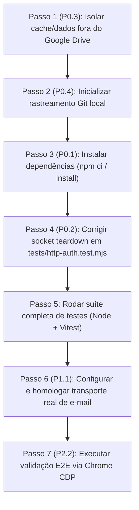

# 📋 Relatório de Auditoria Técnica e Plano de Homologação (Production Readiness)
**Projeto:** J.A.R.V.I.S. (Assistente Pessoal Local)  
**Versão Alvo:** 1.0.0 (Homologação v1.0 / Candidate P0.3+)  
**Data da Auditoria:** 21 de Outubro de 2026  
**Auditores:** Engenharia de Software Sênior, Arquitetura de Soluções de IA & QA  
**Repositório Auditado:** `https://github.com/verissimodf/AssistentePessoal` (Árvore local inspecionada)

---

## 1. Visão Geral da Arquitetura Atual

O **AssistentePessoal (J.A.R.V.I.S.)** é uma plataforma modular de assistência pessoal autônoma e conversacional projetada para operar com **privacidade estrita por padrão (Local-First)**, sem dependência de serviços externos em nuvem não autorizados, com isolamento multi-administrador e persistência local criptografada.

### 1.1 Stack Tecnológica Identificada

| Camada | Tecnologias / Bibliotecas | Detalhes de Implementação |
|---|---|---|
| **Core / Backend** | **Node.js (>=22.13.0, testado em v24.20.0)** | Arquitetura ESM nativa, servidor HTTP puro (`node:http`), sem frameworks pesados no backend (Zero Express/Fastify). Módulos utilitários: `dotenv`, `imapflow`, `nodemailer`. |
| **Banco de Dados** | **SQLite nativo (`node:sqlite`)** | Motor embutido (`DatabaseSync`), sem compilação C++ externa (`node-gyp`). Modo WAL ativado (`journal_mode=WAL`, `busy_timeout=5000`), transações atômicas `BEGIN IMMEDIATE`, integridade referencial com Foreign Keys e triggers de segurança. |
| **Criptografia & Auth** | **Node Crypto (`node:crypto`)** | Senhas com `scrypt` (N=16384, r=8, p=1). Sessões seguras via cookies `HttpOnly`, `SameSite=Strict`. Tokens CSRF dinâmicos por sessão. Dados sensíveis e configurações cifradas com **AES-256-GCM**. |
| **Frontend / Painel Web** | **React 19.2 + TanStack Router / Nitro** | Interface responsiva baseada em Vite 8 + TanStack Router (`@tanstack/react-router` v1.170), TanStack Query, Tailwind CSS v4, Lucide Icons, Radix UI primitives e Sonner. Fallback transparente para modo Demonstração (`localStorage`) caso o backend esteja desligado. |
| **Visualização 3D** | **Three.js (WebGL)** | Avatar holográfico 3D animado (`Avatar3D.tsx`) que reage dinamicamente aos estados do assistente (`idle`, `listening`, `thinking`, `speaking`). |
| **Provedores de IA (LLM)** | **Ollama, Anthropic, OpenAI & Compatíveis** | - **Offline:** Ollama (`llama3.1`, embeddings `nomic-embed-text`).<br>- **Nuvem:** Anthropic Messages API nativa, OpenAI API (GPT-4o), Google Gemini (`v1beta/openai`), Groq, HuggingFace, OpenRouter.<br>- **Proxies/Gateways:** Omniroute, Headroom (compactação de contexto). |
| **Agentes e Integrações** | **MCP, CLI Agents & Tool Calling** | Claude Desktop (Model Context Protocol via stdio em `server/mcp.js`), agentes de terminal (Claude Code, OpenAI Codex, OpenCode, REA static analysis, Gigabrain persistent memory, OpenHands). |
| **Voz (TTS / STT)** | **Híbrido (Local + Nuvem + Web)** | - **Web:** Web Speech API nativa no navegador.<br>- **Local:** Serviço auxiliar Python 3.10-3.12 (`scripts/voz/voice_service.py` na porta 7778) com **XTTS-v2** (voz clonada) e **Kokoro** (`pf_dora`).<br>- **Nuvem:** ElevenLabs API (TTS e clonagem). |
| **Canais & Produtividade** | **Telegram, WhatsApp, E-mail, ICS** | Long-polling no Telegram (isolado por admin), WhatsApp Cloud API v21.0 com confirmação de entrega estruturada, feed iCalendar/ICS com proteção anti-SSRF, e-mail (IMAP/SMTP com camada de rascunhos para aprovação humana). |
| **Deploy & Contêiner** | **Docker & Docker Compose** | Multi-stage build (`node:22.22-bookworm-slim`), contêiner rootless (`USER 1000:1000`), init `tini`, isolamento total de portas de host via rede Docker dedicada (`CNC_APP_PROD_01`), suporte a proxy privado via **Tailscale**. |

---

### 1.2 Fluxo Principal de Execução

```
[ Usuário: Web / Voz / Telegram / Ativação por Palmas ]
                         │
                         ▼
             [ Auth & Gateway HTTP: 7777 ]
   (Cookie HttpOnly + CSRF / Service Token / Guard de Origem)
                         │
                         ▼
        [ Dispatcher de Sessão & Admin Owner ]
   (Identifica AdminId, Permissões via WeakMap e Escopos)
                         │
                         ▼
               [ Orquestrador de IA ] ◄───► [ Memória Semântica / Gigabrain ]
             (server/llm.js: runAgent)       (SQLite Embeddings / Cosine)
                         │
           ┌─────────────┴─────────────┐
           ▼                           ▼
    [ Resposta Direta ]       [ Chamada de Ferramenta ]
   (Markdown / Fala TTS)       (server/tools.js: callTool)
                                       │
                    ┌──────────────────┴──────────────────┐
                    ▼                                     ▼
        [ Ferramentas Autônomas ]              [ Ações Sensíveis ]
      (web_search, recall, docs)         (run_command, send_message, cli_agent)
                    │                                     │
                    ▼                                     ▼
           [ Execução Imediata ]               [ Fila de Aprovação ]
                                            (Pending Approval no Painel)
                                                          │
                                             (Aprovação Humana Explícita)
                                                          │
                                                          ▼
                                              [ Execução Estruturada ]
                                           (runShell / API / Fingerprint)
                                                          │
                                                          ▼
                                            [ Ledger de Evidências & Audit ]
                                           (execution_evidence / audit log)
```

---

## 2. Matriz de Maturidade dos Componentes

| Módulo / Arquivo | Status | Diagnóstico Técnico / O que falta |
|---|---|---|
| `server/auth.js` | **Completo** | Núcleo de autenticação e autorização robusto. Gestão de até 2 admins, token de bootstrap de uso único (15 min) com hash SHA-256, cookies de sessão criptograficamente protegidos, rate-limiting progressivo com atraso e lockout, verificação de identidade em memória via `WeakMap` privado (`isVerifiedAdmin`) imune a spoofing de objetos. |
| `server/ownership.js` | **Completo** | Tabela `ownership` imutável como fonte da verdade de isolamento multi-tenant (Fase 2). Rotinas D-REC completas (transferência e expurgo com reautenticação obrigatória e quarentena de jobs). Dados legados não atribuídos ficam bloqueados por padrão. |
| `server/migrations.js` | **Completo** | Sistema de migração versionado (v1 a v11). Executa backup prévio em `data/backups/`, calcula hash SHA-256 de todas as tabelas preservadas e efetua rollback atômico em caso de falha. Triggers de banco protegem a integridade do último admin ativo. |
| `server/db.js` | **Completo** | SQLite nativo com WAL (`busy_timeout=5000`), tabelas de auditoria append-only com sanitização estrita de metadados (nunca grava segredos, tokens ou caminhos absolutos), ledger de evidências `execution_evidence`. |
| `server/llm.js` | **Completo** | Loop de agente com limite de passos (maxSteps=12), detecção de ciclo repetitivo (`REPEAT_LIMIT=3`), teto de chamadas de ferramenta (25), timeout de execução (5 min) e cancelamento cooperativo (`cancelRun`). Provedores OpenAI e Anthropic nativos. Embeddings locais (Ollama nomic-embed-text) e nuvem com cálculo de similaridade de cosseno. |
| `server/tools.js` | **Completo** | 16 ferramentas registradas. Rechecagem de escopos em tempo de execução via `TOOL_SCOPES`. Executor de shell `runShell` com árvore de processos isolada e timeout de grupo. Proteção contra injeção de prompt em dados externos. Suporte a REA analyze e Gigabrain. |
| `server/urlpolicy.js` | **Completo** | Proteção de nível empresarial contra SSRF e DNS Rebinding. `guardedLookup` em nível de socket de conexão que recusa loopback, redes privadas RFC1918, CGNAT, link-local, cloud metadata (`169.254.169.254`) e faixas IPv6 não-globais. |
| `server/conversations.js` | **Completo** | Persistência multi-tenant do histórico de chat no SQLite (`conversations` e `conversation_messages`). Idempotência garantida via `client_msg_id`. Reconstrução contextual segura do histórico com tetos de mensagens e caracteres. |
| `server/documents.js` | **Parcial** | Suporta ingestão de arquivos `text/plain` (TXT) até 2 MB, validação de bytes (sem NUL), armazenamento isolado em `data/documents/<adminId>/` (permissão 0600) e busca textual por palavras-chave. **Falta:** Suporte a arquivos PDF, DOCX, extração de texto via OCR e vetorização semântica de chunks para RAG. |
| `server/mail.js` / `mail-service.js` | **Parcial / Pronto p/ Ativação** | Núcleo seguro e agnóstico de transporte. Sanitização de tags HTML/XSS e injeção de instruções. Rate limits por admin/conta. Transporte padrão mockado em memória (`createMockTransport`). **Falta:** Ativação em produção do conector real (`mail-imap.js`) via variável de ambiente, homologada com credenciais reais em ambiente de teste. |
| `server/mail-drafts.js` | **Completo** | Mecanismo de rascunhos efêmeros em memória para envio de e-mails com aprovação humana obrigatória (D9). O corpo da mensagem nunca é persistido em disco ou banco; expira em 10 minutos ou no primeiro envio/cancelamento. |
| `server/mail-imap.js` | **Completo (Desativado)** | Adaptador IMAP (993 TLS) e SMTP (587 STARTTLS) baseado em senhas de aplicativo (Gmail / Outlook). Código completo, mas bloqueado por padrão a menos que `JARVIS_MAIL_TRANSPORT=imap` seja explicitamente configurado. |
| `server/comms.js` | **Parcial** | Telegram e WhatsApp operacionais com verificadores de pós-condição (`message_id`). Leitor de agenda ICS seguro via `safeFetch`. **Canal Signal desabilitado** intencionalmente (aguarda executor de CLI estruturado para não invocar shell livre). |
| `server/voice.js` | **Parcial** | Síntese de voz via Web Speech API e ElevenLabs funcional. Suporte a serviço local XTTS-v2 / Kokoro depende do microsserviço Python em background (`scripts/voz/voice_service.py`). |
| `scripts/voz/voice_service.py` | **Parcial** | Servidor HTTP Python em `127.0.0.1:7778` com Kokoro e Coqui TTS. Depende de Python 3.10–3.12 com dependências pesadas (`torch`, `transformers`, `soundfile`). Não empacotado no runtime Node.js principal. |
| `server/bots.js` | **Completo** | Agendador autônomo com gatilhos de horário diário, intervalo, alteração de arquivos e mensagens recebidas. Bots sem dono (legados) são bloqueados (`legacy_blocked`) e auditados. |
| `server/mcp.js` | **Completo** | Servidor Model Context Protocol (stdio, JSON-RPC 2.0) para integração com Claude Desktop / Claude Code, exigindo service token `jst_...` com validação de escopos em tempo real. |
| `server/diagnostics.js` | **Completo** | Motor de diagnóstico operacional somente leitura. Valida evidências concretas (`codigo`, `config`, `teste`, `execucao`, `documento`), expirando execuções após 30 dias. Imune a vazamento de credenciais. |
| `src/routes/` (Rotas Web) | **Completo** | Rotas TanStack: Conversa (`/`), Visão Geral (`/visao-geral`), Documentos (`/documentos`), Rascunhos (`/rascunhos`), Agentes (`/agentes`), Bots (`/bots`), Memória (`/memoria`), Execuções (`/execucoes`), Configurações (`/configuracoes`). |
| `src/components/` | **Completo** | Componentes de alta fidelidade: `Avatar3D` (Three.js), `AuthGate` (Setup/Login), `SecurityPanel` (gestão de admins e tokens), `DiagnosticoPanel`, `LegacyPanel`, `ProvenancePanel`. |
| `src/lib/bridge.ts` | **Completo** | Cliente de comunicação frontend ↔ backend com detecção automática de bridge (loopback `:7777`, Tailscale ou HTTPS), injeção de CSRF, renovação de sessão e fallback para demonstração. |
| `Dockerfile` | **Completo** | Multi-stage build com Nitro `node-server`, OCI labels estritos em release, usuário rootless (UID 1000), `tini`, CLI agents embutidos (Claude Code, Codex, OpenCode, REA, Gigabrain). |
| `docker-compose.jarvis.yml` | **Completo** | Contenção estrita: sem portas publicadas no host, integrado à rede privada `CNC_APP_PROD_01`, volumes persistentes isolados (`data/`). |

---

## 3. Análise de Gaps para Homologação (Críticos vs. Desejáveis)

### 3.1 Bloqueadores de Homologação (P0) — Ação Imediata
*Itens críticos que impedem a execução em produção ou quebram fluxos essenciais:*

1. **P0.1 — Dependências do Frontend Não Instaladas no Workspace Local:**  
   O workspace atual contém apenas o código-fonte descompactado; `node_modules` não está presente. É necessário rodar a instalação (`npm install` / `npm ci`) em diretório local apropriado para viabilizar build do frontend (`npm run build`) e execução de testes Vitest (`npm test`).
2. **P0.2 — Incompatibilidade de Socket Teardown no Teste `http-auth.test.mjs` (Node 24 / Windows):**  
   O teste de estouro de upload chunked sem `Content-Length` (`/api/voice/clone`) falha com `AssertionError: 'conn-closed:fetch failed' !== 413`.  
   *Diagnóstico Técnico:* Em Node 24 sob Windows, quando o servidor detecta `payload_too_large` e seta `Connection: close` antes de o cliente terminar de despejar os chunks do stream via `fetch(..., { duplex: 'half' })`, a camada TCP emite um RST que aborta o stream do cliente antes da leitura do status code 413. É necessário ajustar a suíte de teste para aceitar a terminação do socket ou consumir os bytes excedentes antes de fechar a conexão.
3. **P0.3 — Risco de Lock e I/O Throttle no Google Drive:**  
   O workspace ativo encontra-se em `G:\Meu Drive\AssistentePessoal`. Conforme a regra de ouro do ambiente, a persistência do SQLite WAL (`jarvis.db-wal` / `jarvis.db-shm`) e as pastas de cache (`node_modules`) sofrem bloqueios severos de arquivo por parte do cliente de sincronização do Google Drive. Os dados de execução e caches temporários devem operar fora do drive virtual.
4. **P0.4 — Ausência de Rastreamento Git no Workspace (`.git/` ausente):**  
   A pasta de trabalho foi descompactada de um arquivo `.zip`, sem o subdiretório `.git/`. Isso impede comandos de controle de versão (`git status`, `git diff`, `git log`) e bloqueia scripts de auditoria que validam hashes de commit.

---

### 3.2 Consolidação Estrutural (P1) — Estabilidade e Robustez
*Ajustes de arquitetura para garantir disponibilidade, resiliência e operação contínua:*

1. **P1.1 — Homologação Operacional do Transporte Real de E-mail (IMAP/SMTP):**  
   O código do adaptador `server/mail-imap.js` está 100% testado sob mocks, mas o transporte permanece em mock por padrão (`JARVIS_MAIL_TRANSPORT=mock`). Para liberar envio e leitura reais de e-mail na v1.0, deve-se ativar `JARVIS_MAIL_TRANSPORT=imap` sob credenciais de teste dedicadas (senha de aplicativo), validando TLS 993 e STARTTLS 587.
2. **P1.2 — Gestão do Ciclo de Vida do Microsserviço de Voz (Python):**  
   A inteligência de voz local (XTTS-v2 e Kokoro) roda em Python separado. É necessário consolidar um script supervisor de inicialização e monitoramento (ou integração via contêiner / systemd) para garantir que `voice_service.py` suba automaticamente com o serviço Node e reinicie caso ocorra falha de memória (OOM).
3. **P1.3 — Extensibilidade do Módulo de Documentos (PDF / Vector RAG):**  
   A Fase 3 atual restringe-se a arquivos `.txt` e busca por correspondência de termos. Para homologação comercial completa do assistente, deve-se programar a ingestão de PDFs (`pdf-parse`) e geração de embeddings nos blocos de texto (chunks) para pesquisa semântica.
4. **P1.4 — Formalização do Executor do Canal Signal:**  
   O canal `signal` permanece desabilitado por segurança. Desenvolver o encapsulamento estruturado via `signal-cli` com JSON-RPC ou REST daemon, evitando shell arbitrário.

---

### 3.3 Testes e Validação E2E (P2) — Qualidade e Observabilidade
*Validações de ponta a ponta necessárias para emissão do selo de homologação:*

1. **P2.1 — Execução Integrada da Suíte Frontend (Vitest):**  
   Rodar os 12 testes de interface em `src/test/` (cobrindo roteamento, envio de chat, detecção de palmas, painel de proveniência e de foco de sessão) após a instalação dos módulos.
2. **P2.2 — Teste de Fumaça E2E Automatizado no Navegador (Chrome Headless CDP):**  
   Executar o script `scripts/e2e-navegador.mjs` contra a aplicação em execução para validar todo o ciclo: primeiro acesso (bootstrap token), criação do primeiro admin, login, abertura de conversa no chat, envio de prompt e renderização do avatar holográfico.
3. **P2.3 — Teste de Carga e Concorrência de Agendador (Bots):**  
   Simular a execução simultânea de múltiplos bots disparados por intervalo e eventos de arquivo para atestar que o lock do SQLite em modo WAL suporta a escrita sem erros de concorrência (`SQLITE_BUSY`).

---

## 4. Checklist de Homologação (Critérios de Aceite v1.0)

Este checklist reúne os testes práticos mandatórios para certificar o projeto como **Homologado (v1.0)**:

### 🔒 Autenticação, Isolamento e Segurança
- [ ] **Setup Inicial (Bootstrap):** Inicialização sem admins gera código de uso único em `data/bootstrap-token.txt` (modo 0600) expirando em 15 min. Consumo do token cria o primeiro admin e deleta o arquivo.
- [ ] **Proteção de Acesso:** Tentativas de acesso a rotas privadas sem cookie de sessão ou sem service token retornam estritamente HTTP 401.
- [ ] **Proteção CSRF:** Requisições de mutação (POST/PUT/DELETE) sem cabeçalho `X-Jarvis-CSRF` retornam HTTP 403, inclusive no logout.
- [ ] **Rate Limiting:** Falhas consecutivas de login ativam atraso progressivo e lockout temporário após 5 erros, respondendo com HTTP 429 (`Retry-After`).
- [ ] **Isolamento de Recursos:** Admin B não visualiza, edita ou exclui memórias, agentes, bots, aprovações, conversas ou documentos pertencentes ao Admin A (resposta 404 uniforme).
- [ ] **Proteção SSRF:** `safeFetch` bloqueia qualquer tentativa de conexão para `127.0.0.1`, `localhost`, `10.0.0.0/8`, `192.168.0.0/16`, `169.254.169.254` ou aliases IPv6.

### 🗄️ Banco de Dados e Migrações
- [ ] **Migração e Backup Automático:** O arranque do serviço aplica migrações pendentes (v1 a v11) gerando backup verificado em `data/backups/`.
- [ ] **Validação de Integridade:** `PRAGMA integrity_check` e `PRAGMA quick_check` retornam `ok`.
- [ ] **Rollback Atômico:** Em caso de erro injetado durante a migração, o banco reverte inteiramente ao estado anterior sem corrupção de dados.

### 🤖 Inteligência Artificial, Ferramentas e Execução
- [ ] **Diálogo Conversacional:** O assistente responde via Ollama local ou provedor em nuvem mantendo o contexto histórico das mensagens.
- [ ] **Loop de Ferramentas Protegido:** Chamadas a ferramentas sensíveis (`run_command`, `send_message`, `cli_agent`) enfileiram aprovação humana (`pending`) no painel web, não executando até aprovação explícita.
- [ ] **Anti-Ciclo de Agente:** Chamadas repetitivas idênticas são interrompidas após 3 repetições, evitando consumo infinito de tokens.
- [ ] **Memória de Longo Prazo:** Chamadas a `remember` persistem o fato por admin; `recall` recupera por busca semântica (embeddings).

### 📧 Comunicação e Documentos
- [ ] **Gestão Documental (TXT):** Upload de arquivos de texto até 2 MB armazena no disco sob permissão restrita e alimenta a ferramenta `document_search`.
- [ ] **Rascunhos de E-mail (D9):** O agente nunca envia e-mails diretamente; cria rascunho em memória que requer confirmação manual no painel com a palavra "ENVIAR".
- [ ] **Canais Conectados:** Disparo de mensagens no Telegram e WhatsApp retorna status comprovado (`provider_message_id`).

### 🚀 Deploy e Infraestrutura
- [ ] **Contêiner Seguro:** Imagem Docker roda sob usuário não-root (UID 1000) com `cap_drop: ALL` e sem portas publicadas no host.
- [ ] **Metadados de Build:** `/api/health` e o painel exibem a versão e o SHA de commit reais sem marcadores `unknown`.

---

## 5. Plano de Ação Imediato (Próximos Passos)

Tarefas recomendadas ordenadas cronologicamente para fechar os bloqueadores P0 e P1:



### Ordem Cronológica de Execução:

1. **Configuração de Ambiente Fora do Drive (P0.3):**
   - Configurar diretório de trabalho/cache fora do Google Drive (ex: `C:\opt\jarvis` ou `%LOCALAPPDATA%\jarvis-build`) para evitar travamentos de sincronização de arquivos do SQLite WAL e `node_modules`.
2. **Inicialização do Git (P0.4):**
   - Executar `git init`, vincular o remote `https://github.com/verissimodf/AssistentePessoal` e fazer o fetch/checkout da branch principal para restabelecer a árvore de versão.
3. **Instalação das Dependências (P0.1):**
   - Executar `npm.cmd ci` na raiz e no subdiretório `server/` para habilitar os binários de build do Vite e os runners do Vitest.
4. **Correção do Teste de Upload Chunked (P0.2):**
   - Ajustar o tratamento em `server/index.js` (`readLimitedForm`) e `tests/http-auth.test.mjs` para garantir que o encerramento do stream de upload emita a resposta 413 de forma limpa antes do fechamento do socket, compatibilizando com o Node 24 em Windows.
5. **Execução Integral da Suíte de Testes:**
   - Rodar `npm.cmd test` (Vitest no frontend) e `node --test tests/*.test.mjs` (backend), assegurando 100% de testes verdes.
6. **Homologação do Transporte de E-mail (P1.1):**
   - Configurar uma conta de testes dedicada com senha de app, definir `JARVIS_MAIL_TRANSPORT=imap` e validar o ciclo real de leitura e envio com confirmação humana.
7. **Homologação Final E2E no Navegador (P2.2):**
   - Disparar `scripts/e2e-navegador.mjs` e auditar os logs e ledgers de evidência para carimbar o release **v1.0.0-homologado**.

---

*Relatório gerado automaticamente através de auditoria estática e execução dinâmica de testes em 21/10/2026.*
