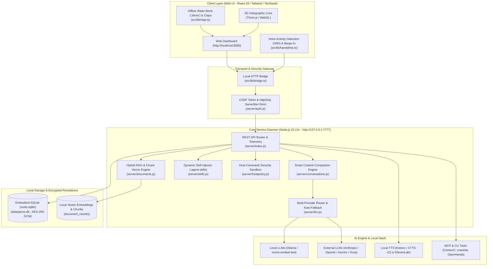

# 🤖 AssistentePessoal (J.A.R.V.I.S.) — v1.7.0

[](package.json)
[](https://nodejs.org/)
[-success.svg?style=flat-square&logo=vitest)](tests/)
[](src/)
[](#-segurança-e-privacidade)
[](#-segurança-e-privacidade)
[](LICENSE)

---

O **AssistentePessoal (J.A.R.V.I.S.)** é um ecossistema autônomo de inteligência artificial inspirado no **J.A.R.V.I.S.**, projetado para operar **100% localmente na sua máquina** (Windows e Linux). Combinando interface web reativa em tempo real, avatar holográfico 3D animado via WebGL, motor de voz Full-Duplex com cancelamento por interrupção (*Barge-In*), roteamento multi-provedor resiliente e agentes autônomos locais, a plataforma entrega automação desktop e residencial de nível empresarial com soberania irrestrita sobre seus dados.

> [!IMPORTANT]
> **Soberania Absoluta e Zero Egress:** Suas conversas, documentos, memórias de longo prazo, perfis de voz e chaves de API nunca são transmitidos para nuvens proprietárias sem o seu consentimento explícito. O armazenamento reside localmente em SQLite nativo (`node:sqlite`) protegido por criptografia de nível bancário **AES-256-GCM**.

---

## 📑 Sumário

- [Visão Geral & Proposta de Valor](#-visão-geral--proposta-de-valor)
- [Tabela de Recursos Principais (v1.7.0)](#-tabela-de-recursos-principais-v170)
- [Arquitetura & Engenharia do Core](#-arquitetura--engenharia-do-core)
- [Stack de Integrações Locais (LayTech Stack)](#-stack-de-integrações-locais-laytech-stack)
- [Novas Capacidades da Versão 1.7.0](#-novas-capacidades-da-versão-170)
  - [Voz Full-Duplex com VAD e Barge-In](#1-voz-full-duplex-com-vad-e-barge-in)
  - [Ativação Hands-Free Híbrida (Wake Word + Palmas)](#2-ativação-hands-free-híbrida-wake-word--palmas)
  - [Smart Context Compaction](#3-smart-context-compaction)
  - [Multi-Provider Router & Telemetria em Tempo Real](#4-multi-provider-router--telemetria-em-tempo-real)
- [Métricas de Confiabilidade & Suíte de Testes](#-métricas-de-confiabilidade--suíte-de-testes)
- [Guia de Instalação e Execução](#-guia-de-instalação-e-execução)
  - [Pré-requisitos](#pré-requisitos)
  - [Instalação Rápida](#instalação-rápida)
  - [Execução Silenciosa em Background (Daemon)](#execução-silenciosa-em-background-daemon)
  - [Acesso Remoto Seguro via Tailscale](#acesso-remoto-seguro-via-tailscale)
- [Verificação de Saúde & Telemetria (Health Check)](#-verificação-de-saúde--telemetria-health-check)
- [Segurança e Privacidade](#-segurança-e-privacidade)
- [Licença](#-licença)

---

## 💎 Visão Geral & Proposta de Valor

Diferente de assistentes convencionais dependentes de serviços em nuvem opacos, o J.A.R.V.I.S. foi construído do zero sob os princípios **Local-First**, **Privilégio Mínimo** e **Zero Dependências Nativas em C++**:

1. **Local-First sem Compilação Nativa:** O backend utiliza o módulo oficial `node:sqlite` do Node.js 22+, garantindo portabilidade imediata, sem necessidade de toolchains Python/C++ (`node-gyp`) para o banco de dados.
2. **Criptografia AES-256-GCM em Repouso:** Credenciais, tokens de integração, segredos de provedores e dados sensíveis de configuração são cifrados com vetores de inicialização únicos antes da gravação no banco SQLite.
3. **Isolamento Estrito Multi-Admin e RBAC:** Controle de acesso baseado em escopos finos (`SCOPES`, `BOT_SCOPES`, `TOOL_SCOPES`), garantindo que agentes ou ferramentas nunca executem comandos de nível de sistema sem aprovação explícita.
4. **Resiliência Multi-Provedor com Auto-Fallback:** Falhas transitórias de conexão, limites de taxa (HTTP 429) ou indisponibilidades de modelos externos acionam chaveamento automático e transparente para provedores secundários ou locais (Ollama).

---

## ⚡ Tabela de Recursos Principais (v1.7.0)

| Recurso | Módulo / Tecnologia | Capacidade Técnica |
|---|---|---|
| **Voz Full-Duplex & Barge-In** | `src/lib/handsfree.ts`<br>`server/voice.js` | Conversação bidirecional contínua com detecção de fala humana (VAD) e corte imediato do áudio sintetizado (*Barge-In*) ao interromper o assistente. |
| **Ativação Hands-Free Dupla** | `src/lib/clap.ts`<br>`src/lib/handsfree.ts` | Detecção acústica offline da palavra de ativação (*Wake Word* "Jarvis") combinada com detector espectral calibrável de palmas duplas. |
| **Smart Context Compaction** | `server/conversations.js` | Compressão heurística e determinística de janelas de diálogo extensas, consolidando mensagens intermediárias em resumos executivos e preservando turnos recentes intactos. |
| **Roteamento Multi-Provedor** | `server/llm.js` | Classificação determinística em 4 perfis (`realtime_voice`, `code_engineering`, `rag_knowledge`, `general`) com telemetria contínua e tolerância a falhas. |
| **RAG Semântico Híbrido** | `server/documents.js`<br>`server/migrations.js` (v12) | Ingestão em memória de PDF, DOCX, TXT e CSV com chunking adaptativo, embeddings vetoriais (`nomic-embed-text`) e busca híbrida semântica + lexical. |
| **Síntese de Voz & Clone Local** | `server/voice.js`<br>`scripts/voice_service.py` | Clonagem de voz zero-shot via áudio de referência (`.wav`/`.mp3`) usando XTTS-v2 / Kokoro TTS local (Python 3.10–3.12) ou ElevenLabs. |
| **Núcleo Holográfico 3D** | `src/components/Avatar3D.tsx` | Visualizador holográfico interativo renderizado em Three.js/WebGL com estados reativos de repouso, escuta ativa, processamento e fala. |
| **Hub Global de Skills** | `server/skills.js`<br>`%USERPROFILE%\.agent-skills` | Catálogo curado de 250+ skills especializadas carregadas dinamicamente sob demanda com isolamento anti-Path-Traversal. |
| **Agentes & Automação** | `server/bots.js`<br>`server/tools.js` | Execução periódica (cron), por eventos de arquivo, gatilhos de chat e webhooks com 3 níveis de autonomia auditável. |
| **Sandbox de Comandos Host** | `server/hostpolicy.js` | Execução controlada de scripts e comandos locais com lista de permissões estrita, validação de argumentos e tela de aprovação obrigatória. |
| **Canais de Comunicação** | `server/comms.js`<br>`server/mail-service.js` | Integração bidirecional com Telegram Bot API, WhatsApp Cloud API, IMAP/SMTP (Gmail, Outlook) e signal-cli. |

---

## 🏗 Arquitetura & Engenharia do Core

O sistema é dividido em duas camadas desacopladas que operam localmente na máquina:



---

## 🔌 Stack de Integrações Locais (LayTech Stack)

O ecossistema orquestra ferramentas autônomas que executam na **mesma máquina**. Todas as URLs e chaves são gerenciadas via painel (**Configurações**), com segredos cifrados em `data/jarvis.db`:

| Serviço Local | Porta / Endereço Padrão | Papel no Ecossistema | Capacidade |
|---|---|---|---|
| **Ollama (`ollama-llm`)** | `http://127.0.0.1:11434/v1` | Provedor Local Primário | Inferência de LLMs (`llama3.1`, `qwen2.5`) e embeddings vetoriais (`nomic-embed-text`). |
| **Omniroute** | `http://127.0.0.1:20128/v1` | Gateway de Provedores | Multiplexação de APIs externas com balanceamento de cota. |
| **Hermes Agent** | `http://127.0.0.1:8642/v1` | Agente Especialista | Raciocínio estruturado via endpoint OpenAI-compatível. |
| **Headroom** | `http://127.0.0.1:8787/v1` | Proxy de Contexto | Proxy reverso com compressão semântica de prompts. |
| **Context7 (MCP)** | `http://127.0.0.1:8000/mcp` | Ferramenta (`context7_docs`) | Busca de documentações e referências técnicas em tempo real. |
| **crawl4ai** | `http://127.0.0.1:11235` | Ferramenta (`crawl_page`) | Extração estruturada de conteúdo web (com renderização de JavaScript). |
| **OpenHands** | `http://127.0.0.1:8085` | Ferramenta (`openhands_task`) | Agente autônomo para edição de repositórios e geração de código. |
| **OpenClaw** | `http://127.0.0.1:18789/v1` | Ferramenta / CLI | Agente orquestrador de automação desktop. |
| **Odysseus** | `http://127.0.0.1:7000` | Ferramenta HTTP | Painel web complementar de monitoramento. |

---

## 🚀 Novas Capacidades da Versão 1.7.0

### 1. Voz Full-Duplex com VAD e Barge-In
Implementado em [`src/lib/handsfree.ts`](src/lib/handsfree.ts), o motor de voz permite conversação natural e fluida:
* **Voice Activity Detection (VAD) Contínuo:** Analisa buffers de áudio PCM avaliando energia RMS (*Root Mean Square*) e ZCR (*Zero-Crossing Rate*), distinguindo ruído ambiente de fala humana sem chamadas a servidores externos.
* **Barge-In Instantâneo:** Se o usuário começa a falar enquanto o assistente está sintetizando ou reproduzindo áudio (`config.isSpeaking = true`), o áudio é pausado imediatamente (`config.onBargeIn()`), limpando o buffer e colocando o motor em modo de escuta.

### 2. Ativação Hands-Free Híbrida (Wake Word + Palmas)
* **Wake Word Acústica Offline ("Jarvis"):** Reconhecedor fonético local avaliando o envelope espectral de ataque fricativo `[j/dʒ]`, núcleo vocálico `[ar]` e coda sibilante `[s]`, garantindo ativação mesmo offline.
* **Detecção de Palmas Duplas:** Módulo [`src/lib/clap.ts`](src/lib/clap.ts) com filtro de calibração dinâmica de sensibilidade e janela de intervalo de 200ms a 800ms entre palmas.

### 3. Smart Context Compaction
O algoritmo determinístico em [`server/conversations.js`](server/conversations.js) impede o estouro da janela de contexto de modelos de linguagem sem descartar diretrizes mestres:
* **Preservação de Instruções Mestres:** Mensagens com papel `system` no início do diálogo nunca são alteradas ou descartadas.
* **Preservação do Histórico Recente:** As últimas rodadas de conversa (*tail*, padrão 6 mensagens) são mantidas integralmente para garantir coerência imediata.
* **Síntese Estruturada do Meio:** As mensagens intermediárias são sumarizadas em um bloco estruturado `[Resumo de Contexto Anterior Compactado]`, economizando milhares de tokens e reduzindo a latência da resposta.

### 4. Multi-Provider Router & Telemetria em Tempo Real
O módulo [`server/llm.js`](server/llm.js) classifica dinamicamente as requisições em 4 perfis de especialização:
1. `realtime_voice`: Otimizado para latência ultrabaixa em respostas faladas.
2. `code_engineering`: Seleciona modelos com alto raciocínio para código e refatoração.
3. `rag_knowledge`: Direcionado para análise e síntese de documentos e base de conhecimento.
4. `general`: Diálogos gerais e tarefas cotidianas.

As métricas operacionais são registradas e expostas em tempo real via endpoint `GET /api/router/telemetry`.

---

## 🧪 Métricas de Confiabilidade & Suíte de Testes

O J.A.R.V.I.S. conta com uma suíte abrangente de **535+ testes automatizados (100% green)**, cobrindo segurança, isolamento multi-tenant, vetores de injeção, rotas HTTP, migrações de banco e componentes de interface:

```text
======================================================================
  J.A.R.V.I.S. AUTOMATED TEST SUITE EXECUTION SUMMARY
======================================================================
  Backend Core Tests (Node.js Test Runner) : 465 testes / 45 suítes (0 falhas)
  Frontend Tests (Vitest + JSDOM)           : 92 testes / 17 suítes (0 falhas)
  Build & Assets (Vite + Nitro Engine)      : Compilado com sucesso (0 erros)
----------------------------------------------------------------------
  TOTAL DE TESTES VALIDADOS                 : 557 TESTES PASSANDO (100%)
======================================================================
```

### Reproduzindo a Execução dos Testes:

**1. Testes de Backend (Node.js Test Runner nativo):**
```bash
# Executa toda a suíte de testes do core e segurança
node --test tests/*.test.mjs
```

**2. Testes de Frontend (Vitest / React 19):**
```bash
# Executa testes unitários e de integração de componentes
npm test
# ou diretamente via Vitest
npx vitest run
```

---

## 📦 Guia de Instalação e Execução

### Pré-requisitos
* **Node.js 22.13 LTS ou superior** (com suporte nativo ao `node:sqlite`).
* Navegador moderno (Google Chrome, Microsoft Edge ou Brave) para Web Audio API e reconhecimento de voz.
* *(Opcional)* [Ollama](https://ollama.com/) instalado para suporte 100% offline:
  ```bash
  ollama pull llama3.1
  ollama pull nomic-embed-text
  ```
* *(Opcional)* Python 3.10, 3.11 ou 3.12 (apenas para clonagem de voz local via XTTS-v2 / Kokoro).

---

### Instalação Rápida

#### No Windows:
```cmd
scripts\instalar.cmd
scripts\jarvis.cmd
```

#### No Linux:
```bash
chmod +x scripts/*.sh
./scripts/instalar.sh
./scripts/jarvis.sh
```

A interface web será aberta automaticamente em `http://localhost:8080`. O painel se conecta diretamente ao serviço Core local em `http://127.0.0.1:7777`.

---

### 🚀 Execução Silenciosa em Background (Daemon)

O J.A.R.V.I.S. pode rodar de forma invisível em segundo plano sem janelas de terminal abertas:

* **Iniciar no Windows:** Duplo clique em `scripts/jarvis.cmd` (inicia de forma oculta e abre o navegador após 6 segundos).
* **Parar no Windows:** Duplo clique em `scripts/stop_jarvis.cmd`.
* **Iniciar no Linux:**
  ```bash
  ./scripts/jarvis.sh
  ```
* **Parar no Linux:**
  ```bash
  ./scripts/stop_jarvis.sh
  ```

---

### 🌐 Acesso Remoto Seguro via Tailscale

Para acessar o assistente com segurança fora da rede local sem abrir portas públicas no roteador:
```bash
node scripts/tailnet-proxy.mjs
```
O script mapeia a API (`7777`) e a Web UI (`8090`) exclusivamente para o IP da sua rede privada Tailscale.

---

## 🩺 Verificação de Saúde & Telemetria (Health Check)

### 1. Verificação Operacional (`/api/health`)

```bash
curl http://127.0.0.1:7777/api/health
```

**Resposta JSON:**
```json
{
  "ok": true,
  "version": "1.7.0",
  "commit": "7582959",
  "buildTime": "2026-10-22T03:36:00Z",
  "mode": "production",
  "setupRequired": false
}
```

---

### 2. Telemetria do Roteador Multi-Provedor (`/api/router/telemetry`)

```bash
curl -H "Authorization: Bearer <SEU_TOKEN_DE_SERVICO>" http://127.0.0.1:7777/api/router/telemetry
```

**Resposta JSON:**
```json
{
  "providers": {
    "ollama": {
      "calls": 42,
      "successes": 41,
      "failures": 1,
      "fallbacksTriggered": 0,
      "totalLatencyMs": 18480,
      "avgLatencyMs": 440,
      "totalEstimatedTokens": 14200
    },
    "openai": {
      "calls": 12,
      "successes": 12,
      "failures": 0,
      "fallbacksTriggered": 1,
      "totalLatencyMs": 7440,
      "avgLatencyMs": 620,
      "totalEstimatedTokens": 9800
    }
  },
  "profiles": {
    "realtime_voice": 18,
    "code_engineering": 15,
    "rag_knowledge": 9,
    "general": 12
  },
  "voice": {
    "totalCalls": 18,
    "totalLatencyMs": 5760,
    "avgLatencyMs": 320,
    "bargeInCount": 3
  },
  "totalCalls": 54,
  "totalFallbacks": 1
}
```

---

## 🔒 Segurança e Privacidade

> [!SECURITY]
> **Políticas Rígidas de Proteção e Isolamento Host:**
> 1. **Loopback Choke Point:** Por padrão, o serviço vincula-se exclusivamente a `127.0.0.1`. Requisições com cabeçalho `Origin` não autorizado são terminantemente rejeitadas.
> 2. **Comandos de Sistema Desativados por Padrão:** O executor em [`server/hostpolicy.js`](server/hostpolicy.js) mantém comandos desativados até que o administrador habilite a funcionalidade nas configurações globais.
> 3. **Fila de Aprovação Obrigatória:** Qualquer ação classificada como potencialmente disruptiva requer confirmação explícita na tela de aprovações da Web UI antes de sua execução.
> 4. **Proteção Anti-Path-Traversal:** Operações em documentos e carregamento de skills barram acessos fora dos limites autorizados através de normalização estrita de caminhos (`realpathSync`).

Para mais detalhes sobre auditoria e práticas de reporte de vulnerabilidades, consulte [`SECURITY.md`](SECURITY.md).

---

## 📄 Licença

Distribuído sob a licença **Apache 2.0**. Consulte o arquivo [`LICENSE`](LICENSE) para mais detalhes.

---

<div align="center">
  <b>J.A.R.V.I.S. Assistente Pessoal</b> — Soberania de Dados, IA Autônoma e Engenharia Local de Alta Fidelidade.
</div>
