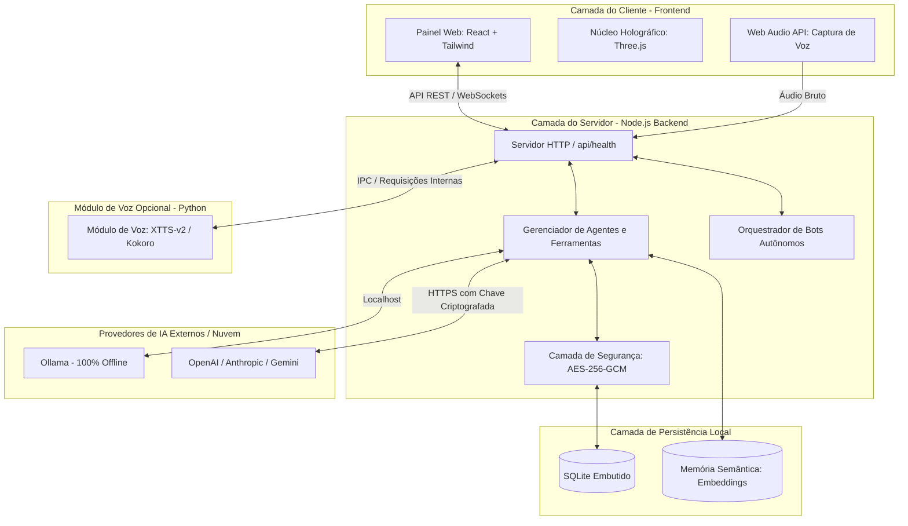
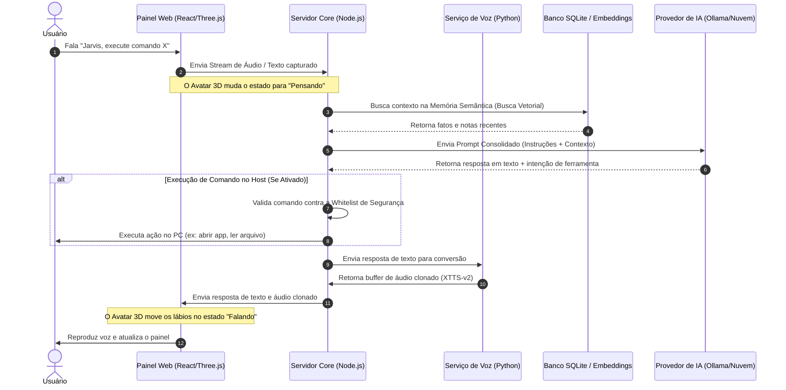

# 🏛️ Arquitetura do Sistema e Fluxo de Dados

Este documento detalha a estrutura de software do **AssistentePessoal** e como os componentes locais interagem entre si para garantir privacidade absoluta, baixa latência e execução offline.

---

## 1. Visão Geral da Arquitetura

O sistema é dividido em três camadas principais operando inteiramente no ecossistema do usuário hospedeiro (*host*):



---

## 2. Fluxo de Execução: Da Entrada de Voz à Ação do Sistema

O diagrama abaixo ilustra o ciclo de vida de uma interação iniciada pelo usuário via comando de voz (por exemplo, usando a *Wake Word* "Jarvis"):



---

## 3. Segurança e Isolamento de Dados

A arquitetura impõe três barreiras rígidas para garantir a integridade do ambiente do usuário:

* **Isolamento de Rede:** O servidor Node.js escuta estritamente na interface de loopback `127.0.0.1`. Requisições externas vindas de fora da máquina local ou de origens não autorizadas são rejeitadas imediatamente no nível de middleware.
* **Criptografia em Repouso:** Dados salvos na pasta `data/` não ficam em texto limpo. Chaves de APIs externas e históricos confidenciais passam pela `SecurityLayer` antes de tocar o arquivo SQLite, utilizando cifra **AES-256-GCM**.
* **Auditoria de Host:** Toda e qualquer chamada de sistema ou bot autônomo acionado gera logs imutáveis gravados localmente, permitindo auditoria completa de processos criados pelo assistente.
* 
## 4. Arquitetura Simplificada

```text
Navegador ── http://localhost:8080 (painel)
   │  detecta automaticamente
   ▼
http://127.0.0.1:7777 (server/index.js)
   ├─ settings.js   chaves cifradas AES-256-GCM
   ├─ db.js         SQLite embutido (node:sqlite) em data/
   ├─ llm.js        provedores + laço de ferramentas do agente + embeddings
   ├─ tools.js      pesquisa, memória, comandos, CLIs, mensagens, e-mail, agenda
   ├─ hostpolicy.js regras de segurança dos comandos
   ├─ bots.js       agendador, observador de arquivos, gatilhos de texto
   ├─ comms.js      Telegram, WhatsApp, Signal, IMAP/SMTP, ICS
   ├─ voice.js      TTS e clonagem ──► scripts/voz/voice_service.py (127.0.0.1:7778)
   └─ mcp.js        servidor MCP (stdio) para Claude Desktop/Code, Codex, OpenCode
```

**Integração painel ↔ serviço**: o painel testa `http://localhost:7777/api/health` a cada 10 s.
Se responder, tudo passa a usar o serviço local; se não, entra em modo demonstração (dados em
`localStorage`). Não há token para parear: o serviço só escuta em localhost e só aceita origens
`localhost`/`127.0.0.1` (configure outras em `JARVIS_ALLOWED_ORIGINS`).

## 5. API
| Método | Rota | Função |
|---|---|---|
| GET | `/api/health` | estado |
| GET/PUT | `/api/settings` | configurações (segredos mascarados) |
| POST | `/api/providers/:id/test` | testa provedor |
| POST | `/api/chat` | conversa com o agente ativo |
| POST | `/api/approvals/:id` | aprova/nega comando |
| CRUD | `/api/memories`, `/api/agents`, `/api/bots` | dados |
| POST | `/api/bots/:id/run`, GET `/api/bots/:id/runs` | execuções |
| POST | `/api/tts`, `/api/voice/clone` | voz |
