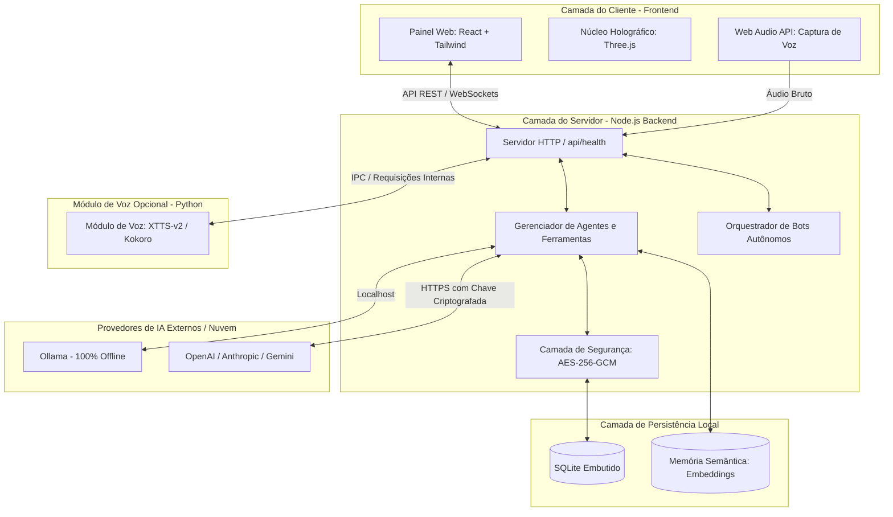
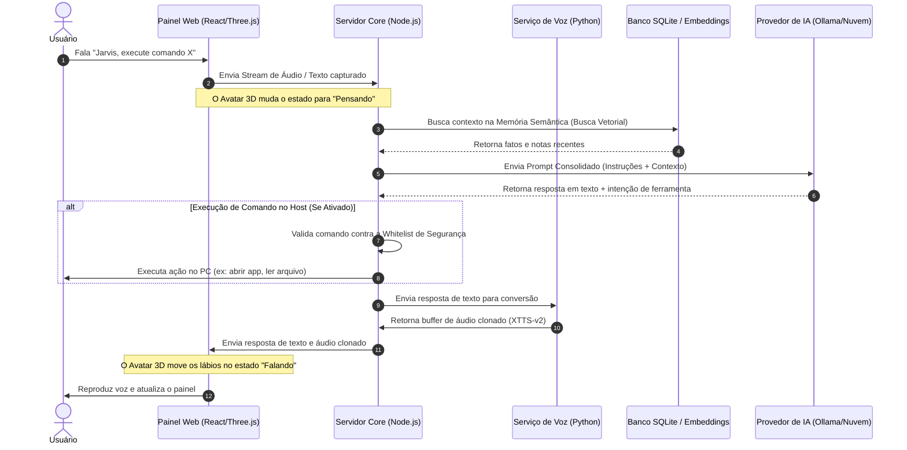
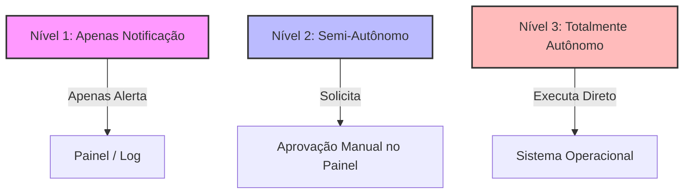

# 🏛️ Arquitetura do Sistema e Fluxo de Dados

Este documento detalha a estrutura de software do **AssistentePessoal** e como os componentes locais interagem entre si para garantir privacidade absoluta, baixa latência e execução offline.

---

## 1. Visão Geral da Arquitetura

O sistema é dividido em três camadas principais operando inteiramente no ecossistema do usuário hospedeiro (*host*):



---

## 2. Fluxo de Execução: Da Entrada de Voz à Ação do Sistema

O diagrama abaixo ilustra o ciclo de vida de uma interação iniciada pelo usuário via comando de voz (por exemplo, usando a *Wake Word* "Jarvis"):



---

## 3. Segurança e Isolamento de Dados

A arquitetura impõe três barreiras rígidas para garantir a integridade do ambiente do usuário:

* **Isolamento de Rede:** O servidor Node.js escuta estritamente na interface de loopback `127.0.0.1`. Requisições externas vindas de fora da máquina local ou de origens não autorizadas são rejeitadas imediatamente no nível de middleware.
* **Criptografia em Repouso:** Dados salvos na pasta `data/` não ficam em texto limpo. Chaves de APIs externas e históricos confidenciais passam pela `SecurityLayer` antes de tocar o arquivo SQLite, utilizando cifra **AES-256-GCM**.
* **Auditoria de Host:** Toda e qualquer chamada de sistema ou bot autônomo acionado gera logs imutáveis gravados localmente, permitindo auditoria completa de processos criados pelo assistente.
* 

## 4. Sistema de Autonomia dos Bots (3 Níveis)

O assistente possui um motor de orquestração autônomo (`BotEngine`) baseado em gatilhos (*triggers*) como horários, intervalos de tempo, arquivos alterados ou mensagens recebidas. Para garantir que a IA não execute ações indesejadas no sistema, a autonomia é rigidamente dividida em 3 níveis configuráveis:



### Detalhamento dos Níveis:

*   **Nível 1: Assistido / Informativo (Modo Seguro)**
    *   **Como funciona:** O bot é disparado por um gatilho, analisa o contexto via IA, mas **não executa nenhuma alteração física ou comando**.
    *   **Comportamento:** Ele apenas gera uma notificação visual no painel web, envia um alerta nos canais de comunicação integrados (Telegram/WhatsApp) ou grava a sugestão em log. Ele avisa o que *deveria* ser feito, mas não age.
*   **Nível 2: Semi-Autônomo (Confirmação Obrigatória)**
    *   **Como funciona:** O bot decide qual ação ou comando do host precisa ser executado, mas a requisição entra em uma **fila de espera**.
    *   **Comportamento:** O indicador do painel web pisca e exibe um pop-up de auditoria. O comando só é disparado no terminal se o usuário clicar fisicamente em **"Aprovar"**. Caso seja rejeitado, a ação é descartada e o bot aprende com a recusa.
*   **Nível 3: Autônomo (Modo J.A.R.V.I.S. Total)**
    *   **Como funciona:** O bot tem permissão livre para tomar decisões e executar ferramentas em segundo plano sem intervenção humana.
    *   **Comportamento:** Dispara scripts, manipula arquivos permitidos na *whitelist*, gerencia comunicações e interage com o sistema operacional. **Requisição obrigatória:** Exige que as travas de segurança do arquivo `SECURITY.md` estejam explicitamente aceitas no ambiente.

---

## 5. Guia de Configuração: Inicialização Automática (Boot)

Para transformar o projeto em um assistente de segundo plano real que liga junto com o computador, configure os inicializadores nativos do sistema operacional:

### 🪟 No Windows (Via Pasta Inicializar)

O método mais simples e seguro no Windows sem exigir privilégios de Administrador é usar o menu `Startup`:

1. Pressione as teclas `Win + R` para abrir a caixa Executar.
2. Digite `shell:startup` e pressione **Enter**. Isso abrirá a pasta de Inicialização do seu usuário.
3. Clique com o botão direito dentro da pasta, vá em **Novo > Atalho**.
4. No campo de localização, clique em procurar e selecione o arquivo do seu repositório: `C:\Caminho\Para\AssistentePessoal\scripts\jarvis.cmd`.
5. Avance, dê o nome de "Jarvis" e conclua. 
6. *(Opcional)* Nas propriedades do atalho, você pode configurá-lo para iniciar em modo **Minimizado** para não abrir a janela do prompt na sua tela ao ligar.

### 🐧 No Linux (Via Systemd Service)

Para distribuições Linux (Ubuntu, Debian, Fedora), a melhor prática de mercado é criar um serviço do sistema:

1. Crie um arquivo de serviço para o Systemd:
   ```bash
   sudo nano /etc/systemd/system/jarvis.service
   ```
2. Cole a configuração abaixo ajustando os caminhos para as pastas corretas do seu usuário:
   ```ini
   [Unit]
   Description=Servico Local do Assistente Pessoal J.A.R.V.I.S.
   After=network.target

   [Service]
   Type=simple
   User=SEU_USUARIO_LINUX
   WorkingDirectory=/home/SEU_USUARIO/AssistentePessoal
   ExecStart=/home/SEU_USUARIO/AssistentePessoal/scripts/jarvis.sh
   Restart=on-failure
   RestartSec=10

   [Install]
   WantedBy=multi-user.target
   ```
3. Recarregue os daemons, habilite o serviço para iniciar no boot e ligue-o agora:
   ```bash
   sudo systemctl daemon-reload
   sudo systemctl enable jarvis.service
   sudo systemctl start jarvis.service
   ```
4. Para checar se está rodando perfeitamente: `sudo systemctl status jarvis.service`.

## 6. Arquitetura Simplificada

```text
Navegador ── http://localhost:8080 (painel)
   │  detecta automaticamente
   ▼
http://127.0.0.1:7777 (server/index.js)
   ├─ settings.js   chaves cifradas AES-256-GCM
   ├─ db.js         SQLite embutido (node:sqlite) em data/
   ├─ llm.js        provedores + laço de ferramentas do agente + embeddings
   ├─ tools.js      pesquisa, memória, comandos, CLIs, mensagens, e-mail, agenda,
   │                context7_docs (MCP), crawl_page (crawl4ai), openhands_task (OpenHands)
   ├─ hostpolicy.js regras de segurança dos comandos
   ├─ bots.js       agendador, observador de arquivos, gatilhos de texto
   ├─ comms.js      Telegram, WhatsApp, Signal, IMAP/SMTP, ICS
   ├─ voice.js      TTS e clonagem ──► scripts/voz/voice_service.py (127.0.0.1:7778)
   └─ mcp.js        servidor MCP (stdio) para Claude Desktop/Code, Codex, OpenCode
```

**Acesso pela rede privada (Tailscale)**: `scripts/tailnet-proxy.mjs` publica as portas 7777 (API) e
8090 (painel) no IP do tailnet, encaminhando para o loopback — sem expor na LAN. O painel detecta o
endereço do serviço pelo hostname da página (`src/lib/bridge.ts`).

**Integração painel ↔ serviço**: o painel testa `http://localhost:7777/api/health` a cada 10 s.
Se responder, tudo passa a usar o serviço local; se não, entra em modo demonstração (dados em
`localStorage`). Não há token para parear: o serviço só escuta em localhost e só aceita origens
`localhost`/`127.0.0.1` (configure outras em `JARVIS_ALLOWED_ORIGINS`).

## 7. API
| Método | Rota | Função |
|---|---|---|
| GET | `/api/health` | estado |
| GET/PUT | `/api/settings` | configurações (segredos mascarados) |
| POST | `/api/providers/:id/test` | testa provedor |
| POST | `/api/chat` | conversa com o agente ativo |
| POST | `/api/approvals/:id` | aprova/nega comando |
| CRUD | `/api/memories`, `/api/agents`, `/api/bots` | dados |
| POST | `/api/bots/:id/run`, GET `/api/bots/:id/runs` | execuções |
| POST | `/api/tts`, `/api/voice/clone` | voz |
