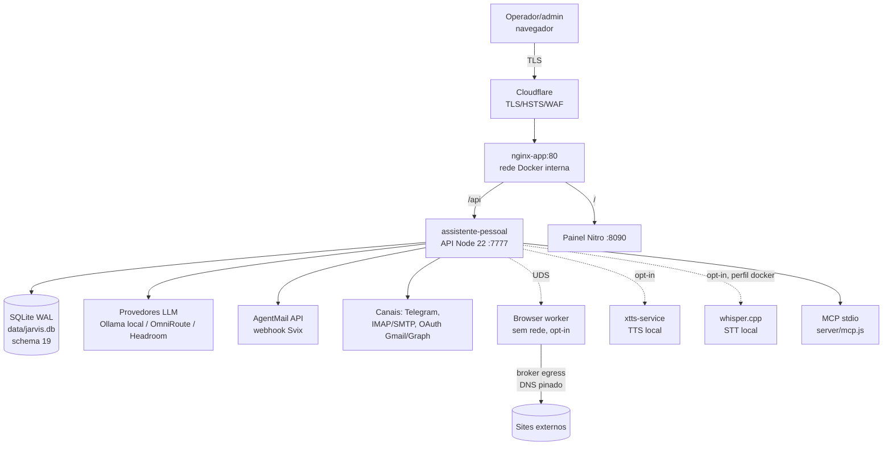
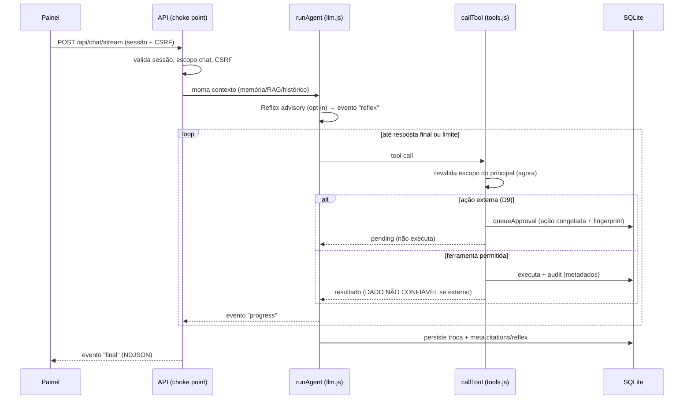
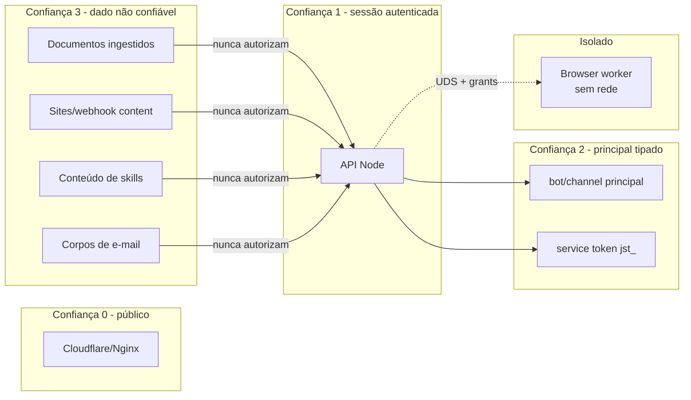

# 02 — Arquitetura Atual (as-is)

Reconstruída do código e confirmada contra `docs/ARQUITETURA.md` (1.10.0, schema 19). Cada
elemento referencia implementação real verificada na Fase 0.

## 1. Contexto do sistema

Sem `ports:` no host; a borda pública é Nginx/Cloudflare (`docker-compose.yml`). Componentes
opcionais (stt, browser) são perfis Compose isolados, desligados por padrão.

## 2. Componentes

| Camada | Módulo | Responsabilidade (verificada) |
|---|---|---|
| HTTP/API | `server/index.js:1270-1307` | Choke point único de authn/authz: Bearer/cookie, CSRF em mutações, `isVerifiedAdmin` para rotas de sessão; lista pública mínima assegurada por `tests/http-auth.test.mjs` |
| Auth | `server/auth.js` | Sessões (idle 30 min / absoluta 12 h), tokens `jst_` sem wildcard, scrypt com throttling progressivo, `can()` deny-by-default (`:570`) |
| Ownership | `server/ownership.js` | Tabela `ownership` imutável (trigger proíbe UPDATE); sem owner = invisível; claim/transferência/purga em 2 estágios |
| Conversas | `server/conversations.js` | Persistência idempotente (`client_msg_id`), contexto 40 msgs/48k chars, compactação extrativa, citações em `meta.citations` |
| Reflex | `server/reflex.js` | Classificador advisory pré-resposta (opt-in, 8 s, fail→fallback explícito); nunca autoriza |
| Router LLM | `server/llm.js:294-521` | `runAgent` com deadline 5 min, fallback em cadeia, anti-ciclo (`REPEAT_LIMIT=3`), telemetria em memória |
| Agentes/bots | `server/bots.js`, `server/jobs.js` | Scheduler 20 s (daily/interval/file), concorrência 2/admin, fila durável v16 com lease/heartbeat/recovery conservador |
| Ferramentas | `server/tools.js` | ~18 tools; `callTool` revalida escopo **na execução** (`:1026-1040`); aprovações D9 com impressão digital revalidada |
| Evidência/auditoria | `server/db.js` | Ledger `execution_evidence` (v10) com `verifiedBy` nomeado; `audit()` imutável (v9), apenas metadados |
| Documentos/RAG | `server/documents.js` | Ingestão txt/md/csv/json/pdf/docx (magic bytes), chunks com embeddings, busca híbrida 0.7/0.3 |
| Memória | `server/memory-retention.js`, `server/tools.js:838-901` | Memórias por admin com embedding opcional; retenção opt-in (v17) com quarentena e purga |
| Skills/MCP | `server/skills.js`, `server/mcp.js` | Catálogo com checksum no provisionamento, confinamento realpath; MCP stdio repassa HTTP com escopos |
| Navegador | `server/browser.js`, `scripts/browser-worker.mjs`, `scripts/browser-egress-proxy.mjs` | Worker sem rede via UDS, egress pinado com grants ≤65 s, writes com `web:write` + aprovação |
| Voz | `server/voice.js`, `server/stt.js`, `scripts/voice-adapter-core.mjs` | TTS XTTS local (fila, cancelamento), STT whisper.cpp opt-in (nunca grava áudio) |
| Voz (ponte) | `server/voice.js`, `server/stt.js`, `scripts/voice-adapter-core.mjs` | validação de amostras e proxy de health |

## 3. Fluxo de execução (mensagem de chat)

## 4. Fluxo de aprovação D9 (ação externa)

1. `queueApproval` (`tools.js:919`) grava em transação `approvals` + `approval_actions`
   (ação estruturada congelada, v6; fills de navegador cifrados, v19) + ownership.
2. Humano revisa (`/api/approvals/:id/review`), `resolveApproval` (`tools.js:1565`) exige
   owner + `isVerifiedAdmin` + revalida portões e impressão digital **no momento da aprovação**;
   claim único `pending→running|denied` via UPDATE condicional (`:1624`).
3. Efeito executado grava evidência (`execution_evidence`) com `verifiedBy` nomeado
   (`exit_code`, `contract_text`, `exception`, `not_executed`, `none` — `tools.js:1516-1549`).
4. Aprovações `running` órfãs no boot viram `interrupted` (`db.js:374-389`) — at-most-once.

## 5. Limites de confiança

Regras observadas no código: saída de LLM não é autorização; conteúdo externo entra marcado como
DADO NÃO CONFIÁVEL (`tools.js:46`, `:249`); escopos são reavaliados por chamada; secrets são
AES-256-GCM em repouso e nunca entram em audit/logs (`db.js:148-179`).

## 6. Persistência (SQLite, schema 19)

19 migrações versionadas com backup verificado `VACUUM INTO` + snapshot SHA-256 de linhas
(`migrations.js:861-879`). Tabelas por domínio: identidade/acesso (v1-2, d-rec v4-5), conversas
(v7-8), evidência/auditoria (v9-10), documentos/RAG (v3, v12), AgentMail (v13-14), agendamento
durável (v15-16), retenção (v17), OAuth (v18), navegador (v19). Lista completa em
`01-EXISTING-CAPABILITY-INVENTORY.md` §26.

## 7. Processamento em background

- Scheduler in-process a cada 20 s (`bots.js:213`), single-instance.
- Fila `durable_jobs` (v16): payload cifrado, lease 90 s, heartbeat 25 s, retry fixo 5 s,
  recovery só de jobs `running` sem `run_id`; com efeito iniciado → `needs_reconciliation`
  (terminal, manual) e claim `interrupted` — nunca re-executa (`jobs.js:157-171`).
- Triggers `message`/`voice` disparam fora da fila (`bots.js:288-291`, fire-and-forget).

## 8. Mapa de integrações

| Integração | Direção | Estado (INTEGRACOES-LAYTECH.md, 2026-10-30) |
|---|---|---|
| Ollama / Headroom / OmniRoute | LLM in/out | Ollama e Headroom OPERATIONAL; OmniRoute OPERATIONAL (SSE) |
| AgentMail | webhook in + REST out | DEPLOYED, inbox reivindicada; corpo nunca persistido |
| Telegram / Gmail IMAP | canal in/out | BLOCKED-CONFIGURATION (credenciais) |
| OAuth Gmail/Graph | out (v18) | implementado, exige configuração explícita |
| xtts-service / whisper.cpp | local | TTS validado; STT opt-in em perfil isolado |
| Gigabrain (MCP stdio) | local | operacional; store compartilhada (ver gap em `05`) |
| REA / OpenHands / crawl4ai | ferramentas | com aprovação/allowlist; OpenHands pode demorar na 1ª execução |
