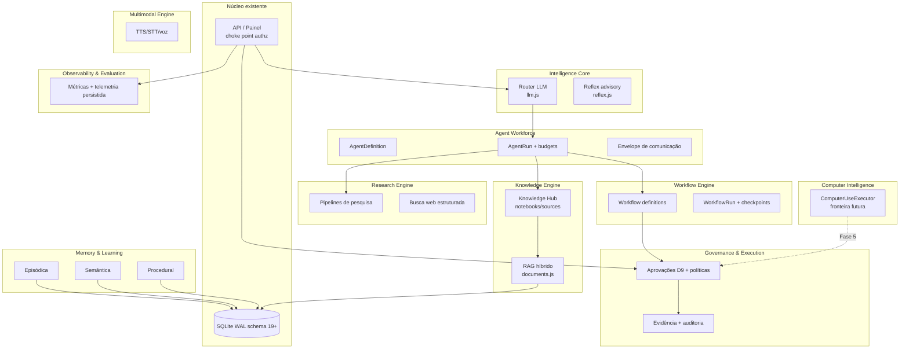

# 03 — Arquitetura-Alvo (J.A.R.V.I.S. Evolution)

## 1. Princípios

1. **O produto atual permanece o centro.** A evolução adiciona contextos ao redor do núcleo
   API+SQLite, sem substituí-lo.
2. **Modular antes de distribuído.** Nenhum contexto novo exige serviço separado; todos vivem no
   mesmo processo Node e no mesmo SQLite até evidência medida exija o contrário
   (`adr/ADR-EVO-001`, `adr/ADR-EVO-010`).
3. **Reutilizar os controles existentes.** Choke point de authz (`index.js:1270`), `callTool`
   com revalidação (`tools.js:1026`), ownership, aprovações D9, evidência nomeada e auditoria
   são a espinha dorsal de todos os contextos novos.
4. **Local-first.** Nenhuma capacidade nova exige nuvem; provedores permanecem substituíveis.
5. **Efeitos externos at-most-once.** Herdado de `jobs.js:158`; vale para agentes, workflows e
   pesquisas.

## 2. Visão geral dos contextos delimitados

## 3. Contextos delimitados

### 3.1 Intelligence Core
- **Propósito:** transformar intenção em execução orquestrada via LLM.
- **Responsabilidades:** roteamento por provedor com fallback, montagem de contexto, orçamento
  de execução, streaming de progresso, Reflex advisory.
- **Não-responsabilidades:** autorizar nada; persistir conversas; definir permissões.
- **Entradas/saídas:** mensagem + contexto → eventos NDJSON + troca persistida.
- **Reutiliza:** `server/llm.js`, `server/reflex.js`, `server/conversations.js`.
- **Novo:** roteamento por perfil efetivo (hoje `classifyTaskIntent` não influencia provider,
  `llm.js:629-669`); orçamento hierárquico (§3.2).
- **Segurança:** contexto é construído no backend; conteúdo externo entra marcado untrusted.
- **Dados:** nada próprio; lê via contexts existentes.
- **Falha:** deadline 5 min, anti-ciclo, fallback em cadeia — manter.
- **Evolução:** streaming de tokens por provedor quando disponível.

### 3.2 Agent Workforce
- **Propósito:** especialistas configuráveis que executam objetivos com delegação limitada.
- **Responsabilidades:** catálogo de AgentDefinitions, execução de AgentRuns (aninháveis),
  orçamento hierárquico, envelope de comunicação entre especialistas.
- **Não-responsabilidades:** conceder permissões (backend decide); executar ferramentas fora de
  `callTool`; automação GUI.
- **Reutiliza:** `server/bots.js` (botPrincipal, concorrência, scheduler), `server/tools.js`
  (revalidação por execução), tabela `ownership` (registro na criação).
- **Novo:** tabelas `agent_definitions`, `agent_runs` (v20+), hierarquia `parent_run_id`,
  sub-orçamento **nunca supera** o do pai; execução sempre com principal propagado.
- **Segurança:** agente não se auto-declara capacidades; delegação transfere objetivo, nunca
  escopos (`adr/ADR-EVO-002`).
- **Falha:** run órfão → estado `unknown` com reconciliação explícita (corrige lacuna de
  `needs_reconciliation`, `01` §14).
- **Evolução:** Fase 1 completa em `08-IMPLEMENTATION-ROADMAP.md`.

### 3.3 Knowledge Engine
- **Propósito:** conhecimento pessoal persistente com proveniência e citação.
- **Responsabilidades:** notebooks pessoal/projeto, fontes multimodais, busca híbrida, relações
  entre entidades, notas e insights.
- **Não-responsabilidades:** memória automática permanente (ingestão é opt-in com revisão —
  `roadmap.md` "Captura de conhecimento"); execução de ações.
- **Reutiliza:** `server/documents.js` (chunks/embeddings/citações), memórias
  (`tools.js:838-901`), migração v17 (quarentena).
- **Novo:** modelo notebook/source/note/insight (padrão Open Notebook) sobre tabelas SQLite;
  índice FTS5 + extensão vetorial embutida (substitui cosine O(N) em JS) — `adr/ADR-EVO-006`.
- **Segurança:** todo recurso com linha em `ownership`; citações com snapshot (padrão já
  existente em `meta.citations`).
- **Falha:** falha de indexação não apaga a fonte; re-index rastreável (padrão DeepTutor
  "index records").
- **Evolução:** Fase 2.

### 3.4 Research Engine
- **Propósito:** pesquisas profundas retomáveis com relatório e fontes.
- **Responsabilidades:** pipeline de pesquisa multi-etapa, coleta com marcação untrusted,
  síntese com citações, sessões retomáveis via checkpoints.
- **Não-responsabilidades:** enviar e-mails/postar; escrever na memória sem revisão humana.
- **Reutiliza:** fila durável v16, `fetchUrl`/safeFetch, RAG, Workflow Engine (Fase 3).
- **Novo:** busca web estruturada com motor dedicado + fallback (substitui scraping único de
  DDG, `tools.js:251`), correlação de fontes.
- **Segurança:** SSRF existente (`urlpolicy`, `browser.js:118`) vale para todo fetch novo;
  conteúdo web nunca autoriza.
- **Falha:** relatório parcial sinalizado como parcial (padrão DeepTutor "partial reports").
- **Evolução:** Fase 4.

### 3.5 Workflow Engine
- **Propósito:** fluxos reutilizáveis, duráveis e retomáveis de passos agênticos/humanos.
- **Responsabilidades:** definição versionada, steps sequenciais/paralelos/condicionais, nós de
  aprovação humana, checkpoints, timeouts, cancelamento, histórico.
- **Não-responsabilidades:** substituir `durable_jobs` (é a infraestrutura de transporte);
  autorizar efeitos (Governance decide).
- **Reutiliza:** `durable_jobs` + leases (v16), approvals D9, `execution_evidence` (v10).
- **Novo:** `workflow_definitions`/`workflow_runs`/`workflow_step_states` (v20+); idempotência
  por step; negócio ≠ técnico completo (`adr/ADR-EVO-004`).
- **Segurança:** cada step que chama ferramenta passa por `callTool`; nó humano = approval D9.
- **Falha:** interrupt → estados unknown até reconciliação; nunca replay cego.
- **Evolução:** Fase 3.

### 3.6 Multimodal Engine
- **Propósito:** voz e conteúdo multimodal como cidadãos de primeira classe.
- **Responsabilidades:** TTS/STT locais opt-in, validação de mídia, futuras imagens/documentos
  visuais.
- **Não-responsabilidades:** capturar/persistir áudio sem indicador e consentimento.
- **Reutiliza:** `server/voice.js`, `server/stt.js`, `scripts/voice-adapter-core.mjs`.
- **Segurança:** regras atuais (nunca gravar áudio em disco, rate-limit, assinatura de mídia).
- **Evolução:** Fase 6.

### 3.7 Computer Intelligence
- **Propósito (futuro):** automação GUI isolada com verificação visual.
- **Fronteira definida hoje:** `ComputerUseExecutor` com sessões isoladas (padrão do worker de
  navegador: processo dedicado, transporte por socket privado, grants curtos, aprovação por
  ação, evidência visual). Nada é implementado na Fase 0; o desenho em `adr/ADR-EVO-008`.
- **Reutiliza (padrão):** arquitetura `browser worker`/`egress broker` — não criar subsystem
  concorrente de navegador.

### 3.8 Governance and Execution
- **Propósito:** decidir e comprovar o que pode executar.
- **Responsabilidades:** aprovações D9, hostpolicy, classificações `verifiedBy`, trilha de
  auditoria; futuro: política comportamental avaliável no backend (guidelines condição→ação
  versionadas, estilo Parlant — `adr/ADR-EVO-007`).
- **Não-responsabilidades:** confiar em auto-relato do modelo; substituir controles por prompt.
- **Reutiliza:** `server/tools.js` (approvals), `server/hostpolicy.js`, `server/db.js`
  (evidence/audit).
- **Segurança:** invariante central — **o backend é o único executor e verificador**.

### 3.9 Memory and Learning
- **Propósito:** memória em três domínios com proveniência e políticas (§05).
- **Reutiliza:** memórias + v17 (quarentena/retention), Gigabrain (com escopo de ownership
  explicitado).
- **Evolução:** Fase 2 (com Knowledge Engine).

### 3.10 Observability and Evaluation
- **Propósito:** medir comportamento sem armazenar conteúdo.
- **Responsabilidades:** métricas (sucesso verificado, falsos sucessos, custo/tarefa, recuperação),
  telemetria persistida com retenção configurável (fecha gap `01` §23), avaliação offline
  estendendo `scripts/evaluate-agent-flows.mjs`.
- **Reutiliza:** `/api/router/telemetry`, `eval:agents`, audit (metadados).

## 4. Estratégia de tecnologia (matriz de decisão)

| Questão | Decisão | Justificativa (evidência) | Alternativa rejeitada |
|---|---|---|---|
| Backend principal | **Manter Node.js 22** | Suíte 688+110 testes, stack única, sem pressão medida | Python sidecars (refs são Python; custo operacional sem benefício medido) |
| Banco de estado | **Manter SQLite WAL** | 19 migrações com backup verificado; concorrência de 1 admin + jobs já atendida | PostgreSQL/Postgres+pgvector (ops extras sem evidência de necessidade) |
| Busca vetorial | **Extensão embutida no SQLite** (FTS5 + sqlite-vec ou equivalente) | Elimina cosine O(N) em JS (`documents.js:515`); zero serviço novo | Serviço vetorial dedicado (Qdrant etc.) — só se medição futura justificar (`adr/ADR-EVO-006`) |
| Knowledge graph | **Tabelas relacionais de arestas** | Escopo pessoal (1 admin); grafo nativo (FalkorDB) é infraestrutura nova sem caso medido | Banco de grafos dedicado |
| Filas/jobs | **`durable_jobs` (SQLite)** | v16 com lease/recovery testado; RabbitMQ/Redis rejeitados no roadmap (2026-10-27) | Redis/RabbitMQ |
| Workflows | **Motor interno em tabelas SQLite** | Reusa leases/approvals/evidence; runners externos (Temporal etc.) = serviço novo | Temporal/n8n/Zeebe |
| Governança comportamental | **Policy engine interno no backend** | Parlant é Python/async com infra própria; conceitos portáveis (`adr/ADR-EVO-007`) | Sidecar Parlant (avaliado na Fase 3 se escala justificar) |
| Computer-use | **Fronteira desenhada, execução na Fase 5** | Agent S é research-grade; risco de input sintético no host exige domínio próprio | Integrar framework Agent S |
| Provedores LLM | **Manter roteador substituível** | Fallback em cadeia já em produção | lock-in de provedor |
| Local-first | **Preservar** | Mandato do produto (`AGENTS.md`, roadmap) | Nuvem-first |

## 5. Decisão de decomposição

Nenhum contexto vira microserviço nesta fase. Critério para revisitar (medido, não especulativo):
(a) concorrência que degrade o SQLite além de `busy_timeout`; (b) carga de CPU de IA local que
compita com a API; (c) isolamento de segurança exigir processo separado (como já ocorre com
browser worker). Quando isso ocorrer, o padrão é o já estabelecido: perfil Compose isolado com
transporte por socket privado — não novo banco/rede compartilhada.
