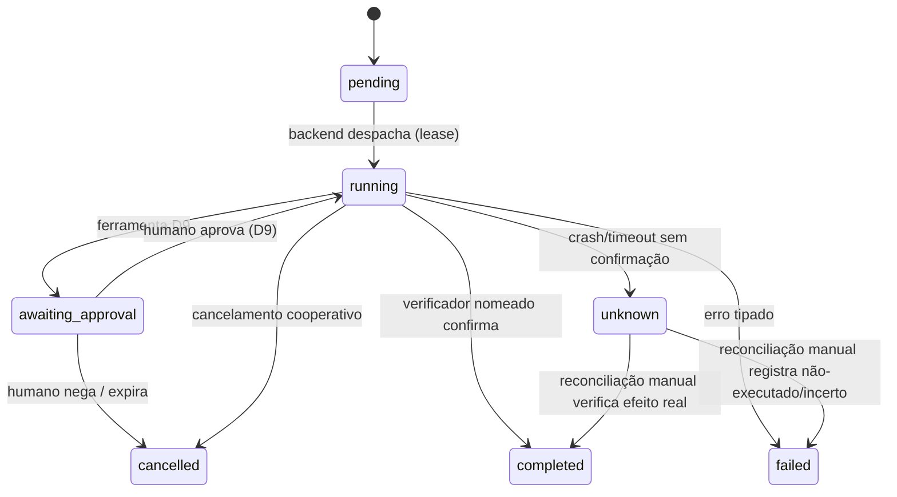
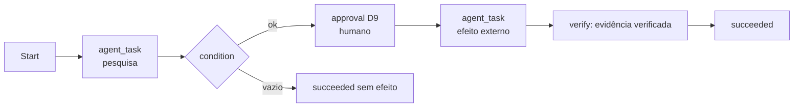

# 04 — Contratos de Agent Workforce e Workflow

Contratos **conceituais** desta fase: definem dados, estados e regras que a implementação (Fase 1+)
deve satisfazer. Modelados sobre a infraestrutura existente (principals de `server/auth.js`,
revalidação de `server/tools.js:1026`, fila `durable_jobs` v16, ledger `execution_evidence` v10).
Todas as tabelas novas entram por migrações versionadas v20+ com backup verificado
(`adr/ADR-EVO-003`, `adr/ADR-EVO-004`).

## 1. AgentDefinition

Definição versionada de um especialista. Persistida e com ownership obrigatório.

| Campo | Tipo | Regras |
|---|---|---|
| `id` | uuid | estável |
| `name` | texto único por admin | legível |
| `version` | inteiro | incrementa a cada edição; runs referenciam a versão exata |
| `role` | enum | `orchestrator` \| `specialist` \| `worker` |
| `description` | texto | propósito legível |
| `instruction_reference` | FK p/ fonte de instruções | conteúdo somente leitura, com checksum e procedência (fecha gap de `skills.js` — TH-03) |
| `model_preferences` | json | provedores/modelos preferidos; router mantém fallback |
| `permitted_tools` | lista de ids de tool | subconjunto das TOOL_DEFS; nunca vírgula-curinga |
| `permission_scopes` | lista de escopos | subconjunto dos SCOPES de `server/auth.js`; sem `*` (mesma regra de `resolveBotScopes`, `auth.js:102-106`) |
| `resource_budget` | AgentBudget (§6) | limites declarados |
| `execution_limits` | json | maxSteps, deadline, concorrência |
| `enabled` | bool | desabilitado não executa |
| `owner` | admin_id | linha em `ownership` (tipos novos em `TYPES`) |
| `created_at`/`updated_at` | timestamps | — |

**Regras de segurança:** escopos e ferramentas são resolvidos e revalidados pelo backend em cada
execução — um AgentDefinition não "carrega" autorização, apenas **solicita**; o effective set é
`requested ∩ granted(principal) ∩ enabled`. Nenhum agente pode editar o próprio definition em
runtime nem o de outro admin.

## 2. AgentRun

Uma execução concreta de um AgentDefinition.

| Campo | Tipo | Regras |
|---|---|---|
| `run_id` | uuid | PK |
| `agent_id` + `agent_version` | FK | versão imutável durante o run |
| `requesting_user` | principal | admin/sessão/bot que originou — propagado, nunca recriado pelo agente |
| `parent_run_id` | FK opcional | hierarquia de delegação (profundidade limitada pelo budget) |
| `objective` | texto | objetivo declarado |
| `status` | enum | `pending → running → awaiting_approval → completed \| failed \| cancelled \| unknown` |
| `correlation_id` | uuid | agrupa run raiz + descendentes |
| `idempotency_key` | texto único | escopado ao requester (padrão `client_msg_id` v7 / `trigger_key` v15) |
| `budget_snapshot` | json | orçamento alocado pelo pai (sub-orçamento ≤ orçamento pai restante) |
| `created_at`/`started_at`/`finished_at` | timestamps | — |
| `result_reference` | FK p/ artefato | saída estruturada |
| `evidence_reference` | FK p/ `execution_evidence` | comprovação |

**Máquina de estados:**

**Invariantes:** `unknown` nunca transita automaticamente (herda `jobs.js:158`); `completed`
exige verificador nomeado (padrão `verifiedBy`, `tools.js:1516-1549`); run órfão em boot vira
`unknown` (corrige o órfão eterno `running` de `01` §14 — `adr/ADR-EVO-003`).

## 3. TaskDefinition

Tarefa reutilizável composta por um especialista.

- `task_id`, `version`, `name`, `description`
- `input_contract`: schema JSON dos campos obrigatórios/opcionais
- `agent_id`: especialista executor preferido
- `dependencies`: tarefas que devem estar completas (por `correlation_id`)
- `timeout_ms`, `retry_policy` (max, backoff), `expected_outcome` (schema do resultado)
- `verification`: que verificador nomeado valida o resultado
- `side_effects`: `none | internal | external` — `external` força caminho de aprovação D9

## 4. TaskExecution

Instância persistente de uma TaskDefinition dentro de um AgentRun.

- `execution_id`, `task_id+version`, `run_id`, `status` (mesma máquina de AgentRun)
- `input_snapshot` (cifrado se contiver dados sensíveis, padrão v16/v19)
- `checkpoint`: último passo ínterno confirmado (para retomada **interna**)
- `attempt`, `max_retries` com backoff exponencial (corrige retry fixo de 5 s de `jobs.js:133`)
- `cancellation`: cooperativo (flag checada entre passos; efeito iniciado não é interrompido à
  força — vai a `unknown`)
- `reconciliation`: quem verificou o quê após `unknown`; resultado só entra como
  `completed` se verificador nomeado confirmar o efeito real.

## 5. AgentCommunication

Envelope estruturado entre especialistas — **uma mensagem nunca é autorização**.

| Campo | Regra |
|---|---|
| `message_id`, `from_run`, `to_run` | correlação |
| `type` | `task_request`, `task_result`, `error`, `context_share` |
| `payload` | schema-conforme à TaskDefinition |
| `untrusted` | `true` para todo payload derivado de dado externo (web/documento/e-mail/skill) — mantém o padrão `tools.js:46` |
| `authorization` | **não existe campo** — o envelope não transporta permissões; o receptor executa sob o **seu próprio** principal propagado e o `callTool` revalida |

Regras: (a) o pai cria o filho com sub-orçamento e objetivo; (b) o filho não pode escalonar
escopos — `can()` deny-by-default (`auth.js:570`) e principal tipado; (c) resultado do filho é
**dado**, sujeito à mesma regra de não-confiabilidade que qualquer ferramenta; (d) a cadeia
`pai→filho` fica no `correlation_id` para auditoria.

## 6. AgentBudget (limites enforceáveis pelo backend)

| Limite | Enforced em | Valor/tipo |
|---|---|---|
| Delegation depth | criação de run filho (backend) | máx. 3 (padrão; configurável ≤ 5) |
| Nº de especialistas por run raiz | orquestrador | `max_specialists` no budget |
| Tool calls | `runAgent` loop (hoje `maxToolCalls`, `bots.js:117`) | hierárquico: soma dos filhos ≤ orçamento do pai |
| Tokens | provider timeout + orçamento estimado (padrão telemetria `llm.js:690`) | por run e agregado por correlation_id |
| Runtime | deadline por run (hoje 5 min, `llm.js:269`) | pai deduz tempo gasto pelos filhos |
| Retries | `TaskExecution.max_retries` | por step, com backoff |
| Execuções concorrentes | `bots.js:78-93` (2/admin) + leases v16 | mantém-se |

Toda a contabilidade do orçamento é feita **no backend**, persistida no run — o modelo nunca é
fonte de verdade sobre quanto já consumiu.

## 7. Workflow (definição e execução)

Estende §3.5 de `03-TARGET-ARCHITECTURE.md`:

- **WorkflowDefinition** versionada: `steps[]` com `type: agent_task | approval | condition |
  parallel_group | wait`, dependências explícitas (DAG acíclico), `timeout_ms` por step e global.
- **WorkflowRun**: `run_id`, `definition+version`, `correlation_id`, status
  (`running|awaiting_approval|succeeded|failed|cancelled|unknown`), `step_states[]` persistentes
  com checkpoint por step.
- **Idempotência:** cada step tem `step_key` único no run; re-execução de um step já confirmado
  não re-invoca a ferramenta (padrão `INSERT OR IGNORE` de `jobs.js:14`).
- **Retomada:** um WorkflowRun interrompido recomeça **do checkpoint**; steps com efeito externo
  iniciado e não confirmado → `unknown` → reconciliação manual (nunca replay cego).
- **Nós de aprovação:** mapeiam para `queueApproval`/`resolveApproval` D9 existentes; o workflow
  fica `awaiting_approval` até resolução humana.
- **Verificação de resultado:** distinção explícita entre **sucesso técnico** (step executou sem
  erro) e **conclusão de negócio verificada** (verificador nomeado confirmou o efeito —
  `execution_evidence.verifiedBy`). Um workflow só `succeeded` quando todos os steps com
  `side_effects: external` têm evidência `verified`.

## 8. ToolInvocation (contrato por chamada)

| Campo | Regra |
|---|---|
| `tool_id` | deve existir em TOOL_DEFS (`tools.js:45+`) |
| `input` | conforme schema (migração p/ JSON Schema real — fecha gap de `llm.js:73-87`) |
| `required_scope` | revalidado **na execução** por `callTool` (`:1026-1040`) |
| `side_effects` | `external` ⇒ D9 obrigatório |
| `timeout_ms` | por tool |
| `idempotency` | ferramentas com efeito declaram chave idempotente; retry nunca duplica |
| `verification` | verificador nomeado exigido p/ considerar sucesso |

## 9. Relação com a infraestrutura existente

- `durable_jobs` (v16) transporta a execução — workflows não criam fila nova.
- `bot_schedule_claims` (v15) continua o ledger de disparos.
- `execution_evidence` (v10) e `audit()` continuam os únicos registros de comprovação — um run
  sem evidência não comprova nada.
- `ownership` ganha tipos `agent_definition` e `agent_run` na criação (fecha o risco de recursos
  "unowned" apontado em `01` §2).
