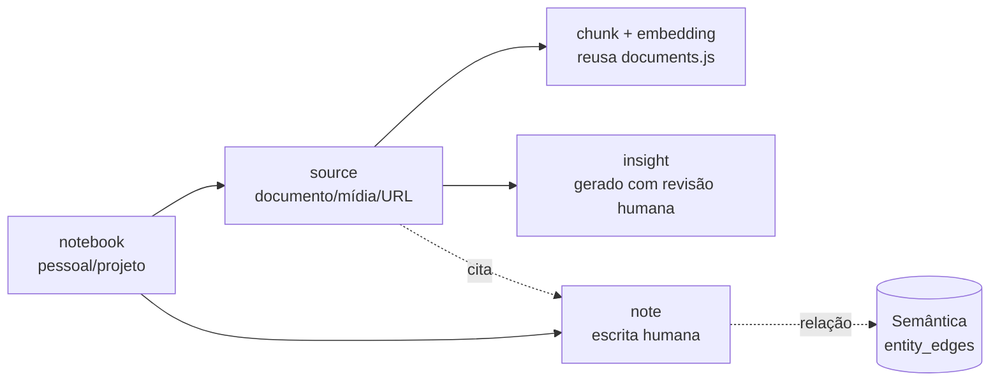

# 05 — Arquitetura de Conhecimento e Memória

Evolução da infraestrutura existente (memórias por admin `tools.js:838-901`, quarentena v17
`memory-retention.js`, RAG `documents.js`) para três domínios de memória distintos e um Knowledge
Hub. Nada aqui introduz memória automática permanente: ingestão, correção, retenção e exclusão
seguem políticas explícitas (`adr/ADR-EVO-005`, `adr/ADR-EVO-006`).

## 1. Três domínios de memória

| Domínio | O que guarda | Fonte | Reuso atual | Novo |
|---|---|---|---|---|
| **Episódica** | Ocorrências: conversas, execuções de runs, pesquisas concluídas, eventos relevantes | Derivada automaticamente de registros já persistidos (conversas v7, runs, evidência v10) | `conversations`, `agent_runs` (futuro), `execution_evidence` | Visão consolidada ("timeline") por admin, com referências aos registros originais — não duplica conteúdo |
| **Semântica** | Entidades, fatos, conceitos, projetos, relações | Memórias atuais + Knowledge Hub (notas/insights confirmados) | `memories` + embeddings | Tabela de relações (`entity_edges`): `subject → predicate → object` com proveniência |
| **Procedural** | Procedimentos operacionais verificados, workflows reutilizáveis, padrões de execução bem-sucedidos | Workflows com evidência `verified` (v10); skills próprias do admin | `skills/`, `execution_evidence` | "Receitas" extraídas apenas de execuções com verificador nomeado — nunca do auto-relato do modelo |

Regra central: **hipótese ≠ fato**. Toda entrada semântica carrega `kind: fact | hypothesis |
inference`, e apenas `fact` (com proveniência humana ou evidência verificada) participa por
padrão do contexto do modelo. Inference/hypothesis entram só se marcadas e com expiração.

## 2. Contrato comum de entrada de memória

Todo registro nos três domínios carrega:

| Campo | Regra |
|---|---|
| `owner` | admin_id — linha em `ownership` (tipos novos `memory_*` em `TYPES`) |
| `origin` | `human` \| `agent` \| `ingestion` \| `inference` |
| `created_at` / `last_validated_at` | validação é ato explícito (humano ou verificador nomeado) |
| `confidence` | derivada de origem + verificação; nunca auto-declarada pelo modelo |
| `source_reference` | ponteiro para o registro original (conversa, run, documento, URL) |
| `provenance` | cadeia compacta de derivação (quem gerou, a partir de quê) |
| `classification` | escopo de uso: `personal` \| `project:<id>` |
| `retention` / `expires_at` | política herda v17 (opt-in, quarentena, purga em lotes) |
| `correction` / `deletion` | correção descarta embedding antigo e revalida (padrão `updateMemory`); exclusão segue D_REC (purga em 2 estágios, `ownership.js:262`) |
| `access` | permissão = ownership + escopo da rota/tool; filtrado por `visibleMemorySql` (`memory-retention.js:139`) |

## 3. Knowledge Hub

Modelo de domínio inspirado em Open Notebook (MIT — ver `07`), mapeado para SQLite:

- **Notebooks** pessoal e por projeto: agregam fontes, notas, insights e conversas de pesquisa.
- **Fontes** reutilizam a ingestão existente (magic bytes, limites, ownership —
  `documents.js:352`); URL é baixada via `safeFetch` com as políticas SSRF atuais.
- **Busca** híbrida: full-text (FTS5) + vetorial (extensão embutida no SQLite) no mesmo banco —
  elimina o cosine O(N) em JS (`documents.js:515-525`) e o recall O(N) de memórias
  (`tools.js:884-901`).
- **Citações:** snapshot pontual no padrão de `meta.citations` (documento, chunk, modo, score no
  instante da resposta) — sobrevive a edição/exclusão posterior.
- **Conversas de pesquisa:** conversas existentes (v7-8) vinculadas ao notebook via
  `classification: project:<id>`.
- **Relações:** arestas `subject→predicate→object` (grafo representado relacionalmente —
  `adr/ADR-EVO-006`); consultas por vizinhança são SQL, não travessia de grafo.
- **Notas e insights:** insight gerado por modelo entra como `kind: hypothesis` e só vira `fact`
  com revisão humana (padrão "prévia editável + confirmação" do roadmap).

## 4. Políticas de memória (o que NÃO muda)

1. **Sem memória automática permanente** por saída de modelo — captura é opt-in com revisão
   (roadmap "Captura de conhecimento opt-in — parcial").
2. **Retenção automática** permanece desativada por padrão; política por admin com preview,
   quarentena restaurável e purga em lotes (v17, `memory-retention.js:88-136`).
3. **Correção** descarta embeddings antigos e gera novo; **exclusão** segue D_REC (transferência,
   reautenticação, expurgo exclusivamente manual).
4. **Auditoria** registra apenas contagens/ids, nunca conteúdo (`db.js:148-179`).

## 5. Gigabrain — memória transversal (gap resolvido no design)

Hoje o Gigabrain (MCP stdio, `tools.js:497-660`) é uma store compartilhada entre admins, fora do
modelo de ownership e da retenção v17. Decisão de design:

- Gigabrain é tratado como **fonte externa** (como conteúdo web): leitura entra no contexto
  marcada untrusted; escrita é ação opt-in existente.
- A memória de domínio da evolução (episódica/semântica/procedural) **não** usa o Gigabrain como
  store; usa as tabelas SQLite com ownership.
- Migração futura (Fase 2): mapear entradas Gigabrain por admin durante leitura (namespace por
  owner) — se a necessidade transversal persistir, fica como decisão de produto explícita.

## 6. Aprendizado

O domínio procedural cresce por: (a) workflows concluídos com evidência `verified` podem ser
promovidos a "receita" reutilizável (proposta, revisão humana obrigatória); (b) falhas
recorrentes documentadas alimentam guidelines de governança (Fase 3) — nunca correções
automáticas silenciosas.
