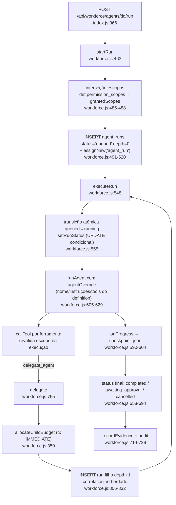

# 01 — Arquitetura: Agent Workforce (Fase 1)

Documentação da camada **implementada** em `server/workforce.js` (1.152 linhas), migração v20
(`server/migrations.js:763-897`), rotas em `server/index.js:911-1002` e UI em `src/routes/workforce.tsx`.
Contratos de origem: `docs/evolution/phase-0/04-AGENT-AND-WORKFLOW-CONTRACTS.md` e
`06-SECURITY-THREAT-MODEL.md` §3.

## 1. Módulos da camada

| Módulo | Responsabilidade | Referência |
|---|---|---|
| `server/workforce.js` | AgentDefinition/AgentRun, orçamento hierárquico, execução, delegação, reconciliação, templates | `workforce.js:1-1152` |
| `server/migrations.js` v20 | Tabelas `agent_definitions`/`agent_runs` + recriação do `ownership` com tipos novos | `migrations.js:763-897` |
| `server/index.js` | 9 rotas HTTP `/api/workforce/*` (dispatcher único: sessão/escopo/CSRF) | `index.js:931-1002` |
| `server/tools.js` | `TOOL_DEFS.delegate_agent` + `case "delegate_agent"` no `callTool` | `tools.js:143-152`, `tools.js:1487-1502` |
| `server/auth.js` | Escopos `workforce:read/write/run`; `TOOL_SCOPES.delegate_agent` | `auth.js:39-41`, `auth.js:87` |
| `server/ownership.js` | `TYPES.agent_definition` / `agent_run`; `assignNew` na criação; `owns` em toda leitura | `ownership.js:17-18` |
| `src/routes/workforce.tsx` | Página do painel (`/workforce`): catálogo, execução, execuções, templates | `workforce.tsx:28` |
| `src/lib/workforce.ts` | Helper de UI: `workforceStatusBadge` (arquivo separado p/ react-refresh) | `workforce.ts:21-54` |
| `src/lib/bridge.ts` | Cliente HTTP tipado (`WorkforceDefinition`, `WorkforceRun`, `WorkforceTemplate`) | `bridge.ts:856-1028` |

## 2. Fluxo de execução

- **Run raiz**: `startRun` grava `correlation_id = id` do próprio run (`workforce.js:503`).
- **Run filho**: `delegate` reusa o `correlation_id` do pai e `parent_run_id` (`workforce.js:818-819`).
- **Runner padrão**: `runAgent` de `llm.js` via import dinâmico; injetável em testes com
  `setDefaultRunner` (`workforce.js:1144-1152`).

## 3. Integração com subsistemas existentes

| Subsistema | Integração | Referência |
|---|---|---|
| **Bots** | Principal do especialista é da classe `bot` (`workforcePrincipal`, `workforce.js:428-430`); bots comuns não têm `workforce:run` (fora de `BOT_SCOPES`, `auth.js:95-103`) | `auth.js:36-41` |
| **Jobs** | Workforce NÃO usa `durable_jobs` — execução é in-process (`executeRun` async); interrupção do processo vira `unknown` no boot | `workforce.js:983-1000` |
| **Approvals (D9)** | `pending` do runner → status `awaiting_approval` (`workforce.js:664-666`); aprovações correlacionadas por `approval_actions.correlation_id` alimentam `verificationOf` | `workforce.js:892-905` |
| **Evidence** | Fim de run grava `recordEvidence({ kind: "workforce_run", ... })`; reconciliação verificada grava evidência `verified` | `workforce.js:714-721`, `workforce.js:1068-1075` |
| **Audit** | Eventos `workforce.definition_created/updated/deleted`, `run_created`, `delegated`, `run_finished/failed/cancelled`, `runs_interrupted`, `run_reconciled` | `workforce.js` (várias) |
| **LLM** | `cancelRun` de `llm.js` aborta a chamada de provider em voo no cancelamento cooperativo | `workforce.js:971`, `llm.js:259-266` |
| **Boot** | `recoverWorkforceRuns()` no start do serviço | `index.js:1505` |

## 4. O que NÃO mudou

- **Dispatcher e authn/authz**: mesmas `route()`/`can()`/CSRF de sempre; a rota de reconciliação
  usa escopo `session` (só admin logado) — `index.js:997`.
- **Ownership**: regras de `ownership.js` intactas; recurso sem dono é invisível (`ownership.js:1-3`).
- **callTool**: revalidação de escopo no momento da execução (`auth.js:52` "re-checked at call time");
  `delegate_agent` apenas entrou no mapa — `auth.js:87`.
- **D9 (aprovação humana)**: envio externo continua enfileirando aprovação; nenhum caminho da
  workforce envia direto (`tools.js:140`, `tools.js:82-83`).
- **Tabela legada `agents`**: store JSON preservada, intocada pela v20 (`migrations.js:764-766`).
- **Migrações**: convenções v2+ mantidas (backup verificado, transação única, snapshot de
  preservação) — ver `02-DATABASE-AND-MIGRATIONS.md`.

## 5. Invariantes herdados da Fase 0 (aplicados no código)

| Invariante (06 §3) | Onde está aplicado |
|---|---|
| Autorização calculada no backend; definition só SOLICITA escopos | `workforce.js:6-7`, `workforce.js:484-488` |
| Delegação transfere objetivo + sub-orçamento, nunca credenciais | `workforce.js:8`, `workforce.js:800-804` |
| Efeito externo iniciado nunca re-executa; interrupção vira `unknown` | `workforce.js:9-10`, `workforce.js:982-1000` |
| Auto-relato não é evidência; `completed` ≠ negócio verificado | `workforce.js:11`, `workforce.js:891-905` |
| Resultado do especialista é DADO NÃO CONFIÁVEL | `workforce.js:573`, `workforce.js:885-889` |
