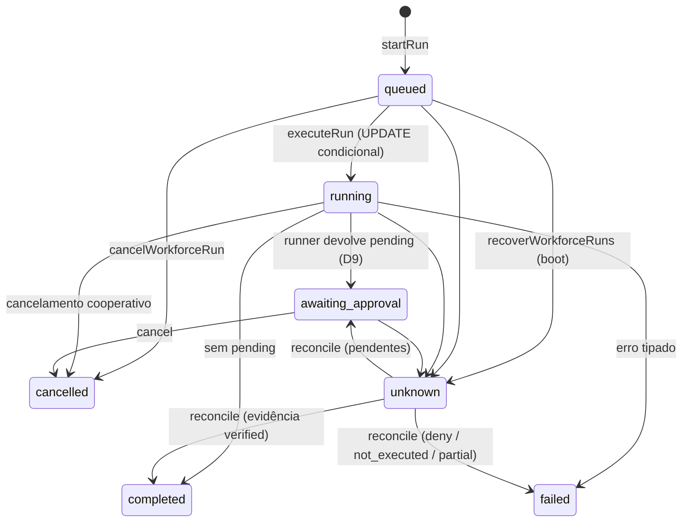

# 05 — Estados de execução e recuperação

Implementado em `server/workforce.js:424-1084` e chamado do boot em `server/index.js:1505`.

## 1. Máquina de estados (TRANSITIONS no código)

`workforce.js:753-758`; verificação em `activeStatutesTransition` (`workforce.js:759-762`).

| De | Para (permitidos) |
|---|---|
| `queued` | `running`, `cancelled`, `unknown` |
| `running` | `awaiting_approval`, `completed`, `failed`, `cancelled`, `unknown` |
| `awaiting_approval` | `running`, `cancelled`, `unknown` |
| `unknown` | `awaiting_approval`, `completed`, `failed` — **só via `reconcileRun` (auditado)** |

## 2. Transição atômica queued→running

`setRunStatus` (`workforce.js:432-459`) faz `UPDATE ... WHERE id = ? AND status = ?` e só considera
sucesso se `changes === 1`. `executeRun` rejeita execução concorrente do mesmo run
(`workforce.js:553-556`); também bloqueia status terminal (`workforce.js:551`).

## 3. Checkpoints (onProgress)

A cada evento `{ type: "step" }` do runner, `checkpoint` persiste
`{ stage: "agent_loop", step, model_calls, tool_calls, correlation, at }` via
`setRunStatus(... "running", "running", { checkpoint })` (`workforce.js:590-604`). Ao fim:
checkpoint `{ stage: "finished", ... }` junto do status final (`workforce.js:687-694`).

## 4. Cancelamento cooperativo

`cancelWorkforceRun` (`workforce.js:964-980`):

| Situação | Comportamento |
|---|---|
| Run em `running` | chama `cancelRun(runId)` de `llm.js` — marca flag e **aborta a chamada de provider em voo** (`workforce.js:971`; `llm.js:259-266`) |
| Qualquer status ativo | transição direta para `cancelled` com `finished_at` + audit `workforce.run_cancelled` (`workforce.js:972-978`) |
| Já terminal (`cancelled/completed/failed`) | `{ unchanged: true }`, nada muda (`workforce.js:968-969`) |
| `unknown` | recusado com `workforce_reconcile_required` (`workforce.js:970`) |

Se o run termina depois do cancelamento, o executor **preserva** `cancelled` (nunca reabre nem
marca falhado) e grava apenas resultado/consumo parciais (`workforce.js:656-712`); limitação
`cancelled_by_user` (`workforce.js:673-677`).

## 5. Recuperação no boot: `recoverWorkforceRuns`

`workforce.js:983-1000`, chamado em `index.js:1505`:

- Runs `queued`/`running` que não estão no conjunto in-process `activeWorkforceRuns` (processo
  morreu) viram `unknown` com `error_code='interrupted'` (`workforce.js:991-994`).
- Um só `audit("workforce.runs_interrupted")` com até 50 ids (`workforce.js:995-998`).
- **Nunca** completam nem re-executam automaticamente.

## 6. Reconciliação auditada: `reconcileRun`

`workforce.js:1007-1084`. Só aceita run `unknown` (`workforce_reconcile_not_unknown`, 1011).
Decisão baseada **apenas** em evidência autoritativa:

1. Aprovações correlacionadas: `approval_actions WHERE correlation_id` (1012-1015).
2. Há aprovações ainda `pending` → run volta a `awaiting_approval` (efeito externo não ocorreu) —
   `outcome: "awaiting_approval"` (1025-1028).
3. Todas resolvidas → `verificationOf` sobre `execution_evidence`:
   `verified` → `completed`/`effects_verified`; `partial` → `failed`/`effects_partial`
   (1030-1036).
4. Todas negadas/canceladas (`denied === approvals.length`) → `failed`/`effects_denied`;
   senão `undetermined` (run permanece `unknown`) (1038-1046).
5. Sem aprovações correlacionadas → `failed`/`not_executed` (1047-1052).
6. `decision` do operador: `"deny"` sempre seguro (`failed`/`operator_denied`);
   `"confirm"` só é aceito se o alvo já era `completed` por evidência — sem evidência retorna
   `workforce_reconcile_no_evidence` (409) (1054-1061).
7. Sucesso grava `recordEvidence` (`verification: "verified"`, `verifiedBy: "exec_evidence"`) e
   audit `workforce.run_reconciled` (1068-1082).

### Casos cobertos em testes

| Caso | Resultado | Teste |
|---|---|---|
| unknown sem aprovações | `failed` (`not_executed`) | `workforce-core.test.mjs:266-281` |
| unknown com aprovação pendente | `awaiting_approval` | `workforce-core.test.mjs:283-302` |
| `confirm` sem evidência via API | 409 `workforce_reconcile_no_evidence` ou `failed(not_executed)` — nunca `completed` | `workforce-security.test.mjs:221-262` |
| reconciliar run não-unknown | erro `workforce_reconcile_not_unknown` | `workforce-core.test.mjs:302` |

## 7. O que nunca acontece

- `unknown` → `completed` **sem evidência** (`verificationOf` é a única via; `confirm` por decreto
  é recusado) — `workforce.js:1056-1061`.
- Replay cego: nenhum caminho re-executa o trabalho de um run interrompido — `recoverWorkforceRuns`
  só marca `unknown` e `reconcileRun` decide por evidência.
- Conversão automática de interrupção em `failed`: só erros conhecidos da execução corrente falham
  (`workforce.js:731-746`); interrupção do processo é `unknown`.
