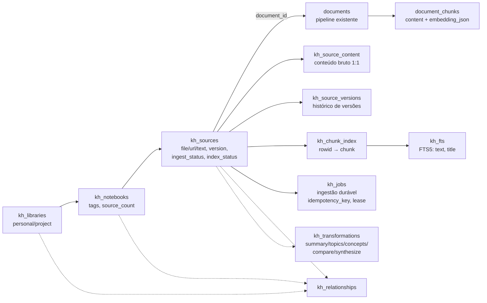

# Arquitetura — Fase 2: Personal Knowledge Hub

Camada de **organização de fontes** sobre o pipeline de documentos existente — chunks,
embeddings, busca e citações não são duplicados (ADR-KH-002, `docs/evolution/phase-2/decisions.md`).

## Visão da camada

## O que é reutilizado vs. novo

| Item | Status | Referência |
|---|---|---|
| `saveDocument` (chunks + embeddings + `rag_status`) | reutilizado | `server/documents.js:370` |
| `searchDocuments` (0.7 semântico + 0.3 lexical, ownership-safe) | reutilizado | `server/documents.js:488` |
| `deleteDocument` (documento + chunks + ownership) | reutilizado | `server/documents.js:620` |
| `reindexDocument` (promove `lexical_only` → `hybrid`) | reutilizado | `server/documents.js:654` |
| SSRF policy (`assertSafeUrl`/`assertPublicHost`/`safeFetch`) | reutilizado | `server/kh-fetch.js:4` |
| LLM one-shot via `runAgent` (mesma telemetria/fallback) | reutilizado | `server/kh-oneshot.js:6` |
| Tabela `ownership` (CHECK estendido com tipos `kh_*`) | recriada na v21 | `server/migrations.js:1031` |
| Rotas de sessão/CSRF existentes (`route`) | reutilizado | `server/index.js:1051` |
| Tabelas `kh_*` (9 tabelas + 1 virtual FTS5) | **novo** | `server/migrations.js:908-1026` |
| Módulo `server/knowledge.js` (CRUD, ingestão, busca, transforms) | **novo** | `server/knowledge.js` |
| `kh-fetch.js` (download de fonte URL com mime/text-only) | **novo** | `server/kh-fetch.js` |
| `kh-oneshot.js` (`runAgentOneShot`, sem loop de ferramentas) | **novo** | `server/kh-oneshot.js` |
| Tools `notebook_search`/`notebook_transform`/`notebook_note` | **novo** | `server/tools.js:153-167` |
| Escopos `kh:read`/`kh:write` | **novo** | `server/auth.js:45-46` |
| Rotas `/api/kh/*` + `khError` (códigos tipados) | **novo** | `server/index.js:1025-1192` |
| Recuperação de jobs no boot (`recoverKhJobs`) | **novo** | `server/index.js:1696` |

## Módulos e responsabilidades

| Módulo | Responsabilidade |
|---|---|
| `server/knowledge.js` | Único ponto de CRUD de bibliotecas/notebooks/fontes, ingestão (`processIngest`), FTS (`indexSourceFts`), pesquisa híbrida (`khSearch`), transformações (`khTransform`), notas (`createNote`), resposta fundamentada (`khAsk`), limites (`KH_LIMITS`) e recuperação (`recoverKhJobs`) — `server/knowledge.js:1-686` |
| `server/kh-fetch.js` | Download seguro de fonte URL: reusa a política de rede existente; valida mime texto (415) e tamanho (413); falha de fetch → `kh_fetch_failed` (502) — `server/kh-fetch.js:9-19` |
| `server/kh-oneshot.js` | Uma chamada ao modelo com contexto fundamentado: `maxSteps=1`, `maxToolCalls=0`, system com regra de citação e marcação de conteúdo não confiável — `server/kh-oneshot.js:5-19` |
| `server/index.js` (seção KH) | Rotas `/api/kh/*` com escopo declarado por rota + mapeamento erro→status HTTP — `server/index.js:1025-1192` |
| `server/migrations.js` v21 | Schema completo, recriação de `ownership` com tipos `kh_library`/`kh_notebook`/`kh_source` preservando linhas — `server/migrations.js:898-1126` |
| `tests/kh-*.test.mjs` (4 arquivos) | Núcleo, migração, segurança E2E HTTP e integração com Workforce |

## Invariantes herdados da Fase 0 (§06 threat model)

1. Ownership verificado no backend em toda leitura/escrita — nunca só na UI (`server/knowledge.js:8`).
2. Conteúdo de fonte é **DADO NÃO CONFIÁVEL** — nunca instrução, nunca autorização (`server/knowledge.js:9`).
3. Falha de indexação nunca concede acesso; excesso/erro falham fechado (`server/knowledge.js:10`).
4. Exclusão remove documento, chunks, FTS, relacionamentos e versões — sem órfãos (`server/knowledge.js:11`).
