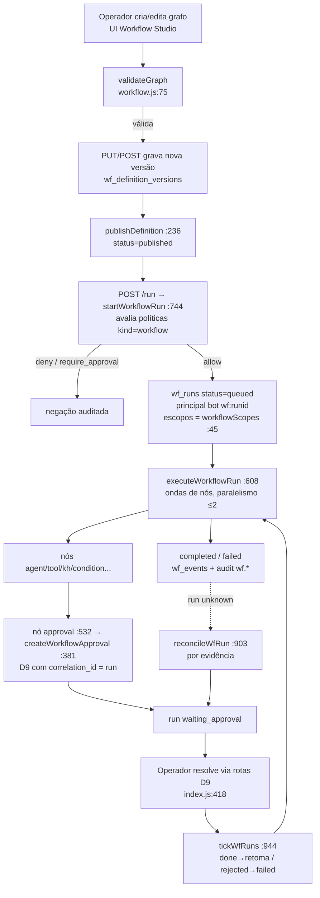

# Arquitetura — Fase 3: Workflow & Behavior Studio

## Visão

Workflows duráveis com definição versionada imutável, execução persistente por nó, eventos,
aprovação humana (D9) e políticas comportamentais determinísticas. **Sem terceira fila de jobs**
(ADR-WF-001, `decisions.md`): executor in-process sobre estado persistido em SQLite, com
recovery no boot e tick de retomada. Fundamentos nas ADRs da Fase 0:
ADR-EVO-004 (execução/recuperação), ADR-EVO-007 (governança comportamental) e
ADR-EVO-009 (evidência e verificação).

## Componentes

| Componente | Arquivo | Responsabilidade |
|---|---|---|
| Motor de workflow | `server/workflow.js` | Validação de grafo (`validateGraph` :75), CRUD de definições (:133), execução por ondas (`executeWorkflowRun` :608), cancelamento (:847), recovery (:873), reconciliação (:903), tick (:944) |
| Policy engine | `server/policies.js` | Políticas versionadas por admin, avaliação determinística fail-closed (`evaluatePolicies` :129), veredito de tool (`toolPolicyVerdict` :270) |
| Integração em `callTool` | `server/tools.js:1066-1082` | Política avaliada antes de toda ferramenta; `force_approval` rebaixa autonomy `full`→`confirm` (:1082) |
| Integração Workforce | `server/workforce.js:479-482` | `startRun` avalia políticas `kind:"agent"`; `require_approval` → negação fail-closed |
| Nós Knowledge Hub | `server/workflow.js:443-477` via `server/knowledge.js` (`khSearch` :604, `khTransform` :736) | Busca híbrida e transformações com citação |
| Rotas HTTP | `server/index.js:1222-1319` (Workflow Studio), `:1321-1357` (Policy Studio) | Acesso declarado por rota (`workflow:read/write/run`; políticas `session`) |
| Boot/tick | `server/index.js:1869-1871` | `recoverWfRuns()` no boot; `setInterval(tickWfRuns, 20_000)` |
| UI | `src/routes/workflows.tsx` (933 linhas), `src/routes/policies.tsx` (517), `src/lib/workflow-ui.ts` | Editor estruturado (ADR-WF-003), painel de runs, simulador de políticas |

## Tabelas (schema v22, `server/migrations.js:1134-1228`)

| Tabela | Papel |
|---|---|
| `wf_definitions` | Definição (nome, status draft/published, `current_version`, `allowed_tools`) |
| `wf_definition_versions` | Grafo imutável por versão (`UNIQUE(definition_id, version)`) |
| `wf_runs` | Execução (status com CHECK de 8 estados, `budget_json`, `usage_json`, `idempotency_key`) |
| `wf_node_executions` | Execução por nó (`UNIQUE(run_id, node_id)`, `approval_id`, `agent_run_id`, `wake_at`, `attempt`) |
| `wf_events` | Eventos append-only do run (`kind`, `node_id`, `detail`) |
| `wf_policies` / `wf_policy_revisions` | Políticas comportamentais + snapshots versionados |
| `ownership` | Recriada na v22 com os tipos `wf_definition`, `wf_run`, `wf_policy` (`migrations.js:1230-1245`) |

## Fluxo principal

## Reutilizado das Fases 0-2 (nada duplicado)

- **D9 (Fase 0):** nó `approval` cria linha real em `approvals`/`approval_actions`
  (`workflow.js:388-396`); resolução pelas rotas existentes (`index.js:418-457`).
- **Evidência (ADR-EVO-009):** `execution_evidence` vinculada por `correlation` = run e
  `approval_id` (assertado em `tests/wf-security.test.mjs:219-225`).
- **Workforce (Fase 1):** nós `agent` chamam `startRun` real (`workflow.js:492`); nós
  `subworkflow` chamam `startWorkflowRun` recursivo com `depth` (:517-522).
- **Knowledge Hub (Fase 2):** nós `knowledge_search`/`transform` chamam `khSearch`/`khTransform`
  do owner (:444, :465).
- **Autorização (Fase 0/1):** `can()` no `callTool` (`tools.js:1057`), ownership em toda rota,
  interseção de escopos no Workforce.
- **Filas existentes intocadas:** `durable_jobs` (bots) e `kh_jobs` seguem como estão
  (ADR-WF-001, `decisions.md:3-13`).

## Orçamentos fixos (`WF_BUDGET`, `workflow.js:34-39`)

`runtime_ms` 10 min · `max_nodes` 50 · `max_agent_runs` 10 · `max_depth` 3 (subworkflows);
paralelismo de fan-out `MAX_PARALLEL = 2` (:40).
