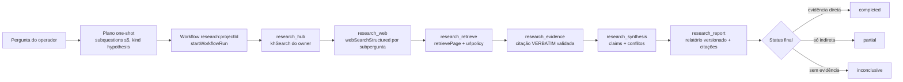

# Arquitetura — Deep Research & Learning (Fase 4)

Visão dos componentes reais implementados. ADRs: `decisions.md` (ADR-RS-001..005).

## 1. Componentes

| Componente | Arquivo | Responsabilidade |
|---|---|---|
| Busca web estruturada | `server/research-search.js` | `webSearchStructured` (provedor `ddg-html`), `retrievePage`, `canonicalizeUrl`, `htmlToText`, `setSearchFetcher` (`research-search.js:8-175`) |
| Motor de pesquisa | `server/research.js` | Projetos, plano, executores dos 6 nós, evidências verbatim, claims/conflitos, relatórios versionados (`research.js:1-638`) |
| Learning Engine | `server/learning.js` | Projetos, jornada (módulos/lições), tutor, atividades/tentativas, diário, progresso (`learning.js:1-383`) |
| One-shot LLM | `server/kh-oneshot.js` | Uma chamada de modelo sem loop de ferramentas (`kh-oneshot.js:5-22`) |
| Registry de nós | `server/workflow.js` | `registerNodeType`/`registerNodeExecutor` (`workflow.js:25-33`) |
| Política de rede | `server/urlpolicy.js` | `assertSafeUrl`, `assertPublicHost`, `safeFetch` com IP fixado (`urlpolicy.js:81,106,179`) |
| Rotas HTTP | `server/index.js` | Seções "Deep Research" (`index.js:1388-1444`) e "Learning Studio" (`index.js:1446-1543`) |
| Esquema | `server/migrations.js` | Migração v23: tabelas `research_*` e `learn_*` (`migrations.js:1340-1493`) |
| UI | `src/routes/research.tsx`, `src/routes/learning.tsx` | Páginas Deep Research e Learning Studio (falam só com o server via HTTP) |

## 2. Fluxo de investigação (pergunta → relatório)

O pipeline é um workflow da Fase 3 com grafo fixo auto-gerado (`research.js:230-250`):

Execução real: `executeResearch` (`research.js:183-218`) cria/reutiliza a definição `research:<projectId>`
(`ensureResearchWorkflow`, `research.js:225-253`), publica e roda via `startWorkflowRun`
(`research.js:270-272`). Aprofundamento: `deepenResearch` zera `workflow_run_id` e re-executa
(`research.js:618-638`).

## 3. Reuso das Fases 1-3

| Fase | Reuso na Fase 4 |
|---|---|
| F1 Workforce | Nós `agent` de definições do operador; escopos derivados de `allowed_tools` (`workflow.js:55-64`); interseção de escopos na delegação |
| F2 Knowledge Hub | `khSearch` para fontes `origin:'hub'` (`research.js:292-309`); fontes do Hub como contexto do Learning (`learning.js:109-126`); one-shot reutiliza `runAgent` com telemetria (`kh-oneshot.js:6-20`) |
| F2 urlpolicy | `safeFetch`/`assertSafeUrl`/`assertPublicHost` em busca e recuperação (`research-search.js:5`) |
| F3 Workflow Engine | Execução durável, checkpoints por nó, retomada, reconciliação, orçamento `WF_BUDGET` (`workflow.js:44-49`), políticas (`workflow.js:764-781`) |
| F3 Ownership | `assignNew`/`owns` em `research_project`/`learn_project` (`research.js:88,95`; `learning.js:62,72`); tipos no CHECK de `ownership` (`migrations.js:1499`) |

## 4. Princípios (invariantes)

1. Provedor indisponível → `partial`/`inconclusive` explícito; nunca resultado fictício (`research.js:5-6`, `research-search.js:82-105`).
2. Evidência só entra com citação VERBATIM validada no servidor (`research.js:443`).
3. Conteúdo recuperado/injetado no prompt é DADO NÃO CONFIÁVEL (`research.js:425,477`; `learning.js:120,194,226,292`).
4. Progresso de aprendizagem = contagens; nada vira memória automática (`learning.js:343-373`).
5. Ownership por `principal.adminId` em toda leitura/escrita; cross-owner = 404.
