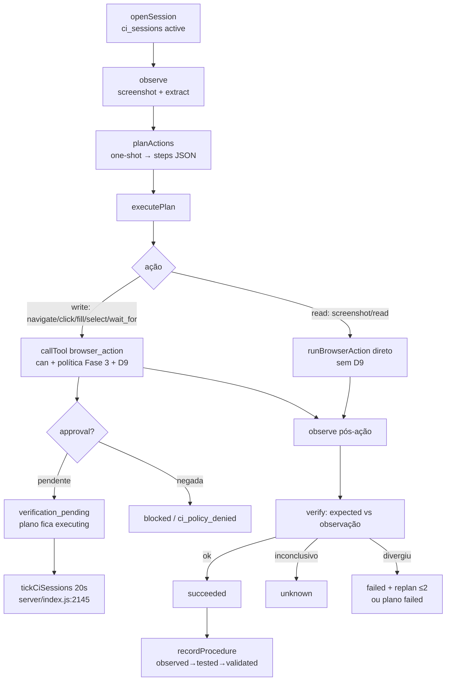

# Fase 5 — Computer Intelligence: Arquitetura

## Visão geral

Motor de sessões de navegador isoladas que reutiliza integralmente o worker Playwright
existente (Fases anteriores, ADR-EVO-008), adicionando: observação com evidência, planos
estruturados via one-shot, execução sob política/D9, verificação por critério e memória
procedural. **Sem desktop nativo** — a fronteira GUI nativa do ADR-EVO-008
(`docs/evolution/phase-0/adr/ADR-EVO-008-computer-use-isolation.md`) permanece diferida;
nada de xdotool/janelas foi implementado.

Motor: `server/computer.js` (487 linhas). Schema: migração `version: 24`
(`server/migrations.js:1589`).

## Componentes

| Componente | Arquivo | Papel |
|---|---|---|
| Motor CI | `server/computer.js` | sessões, observações, planos, ações, tick, procedimentos |
| Driver navegador | `server/browser.js` | `runBrowserAction` com modos managed/off/remote/unavailable |
| Worker | `scripts/browser-worker.mjs` | Playwright isolado por UDS; `screenshotBase64` (Fase 5) |
| Ferramenta | `server/tools.js:1412` | `browser_action` via `callTool` (can + política + D9) |
| Rotas HTTP | `server/index.js:1400-1479` | seção "Computer Studio" (`/api/ci/*`) |
| Escopos | `server/auth.js:59-60` | `computer:read`, `computer:run` |
| Persistência | `server/migrations.js:1592-1663` | `ci_sessions`, `ci_observations`, `ci_plans`, `ci_actions`, `ci_procedures` |
| Testes | `tests/computer.test.mjs` | aceite de 15 passos com worker fake no mesmo UDS |

## O que é reutilizado (nada foi duplicado)

- Worker Playwright + broker de egress + UDS privado: `server/browser.js:281-341`,
  `scripts/browser-worker.mjs:252-258`.
- Portão de escrita `browser_action` (D9): `server/tools.js:1412-1451`, resolução em
  `server/tools.js:1692-1696` (fingerprint + `confirmWrite` para click/fill).
- Policy Engine da Fase 3: `server/tools.js:1069-1082` (`toolPolicyVerdict` dentro de `callTool`).
- Ownership/isolamento por admin: `server/ownership.js` via `assignNew`/`owns`
  (`server/computer.js:9,62,69`).
- One-shot do Knowledge Hub para planejamento: `server/computer.js:169-177`
  (`runAgentOneShot` de `server/kh-oneshot.js`).

## Diagrama do fluxo principal

## Invariantes top-level (todos em `server/computer.js:1-7`)

1. Conteúdo da interface é **dado não confiável** — nunca instrução (`server/computer.js:187`).
2. O modelo não autoriza: escritas sempre passam por D9 humano (`server/computer.js:282-299`).
3. Ações proibidas (pagamento/compra/transferência/exclusão…) são bloqueadas por padrão,
   sem bypass nesta fase (`server/computer.js:39-40`, §9.3 do mandato).
4. `executePlan` nunca fala direto com o worker para escritas — só via `callTool`
   (`server/computer.js:4`).
5. Indisponibilidade é explícita (`ci_browser_disabled`), nunca simulada
   (`server/computer.js:55`).

## Estado da documentação

`security-threat-model.md` e `decisions.md` da Fase 5 citados no plano **ainda não existem**
neste diretório; os únicos documentos de Fase 0 aplicáveis são o ADR-EVO-008 e o threat model
do navegador (`docs/NAVEGADOR.md`).
